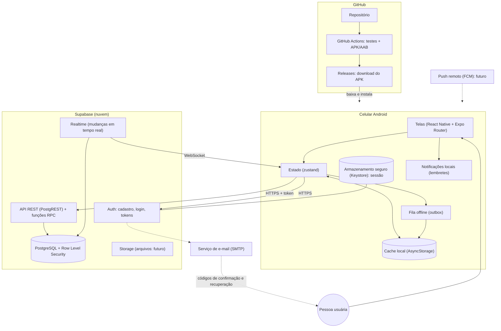
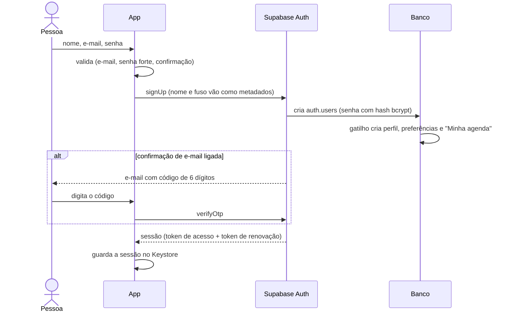

# Arquitetura

Este documento explica como as peças do SynCK se encaixam. Para o porquê de cada escolha, veja [DECISOES.md](DECISOES.md).

## Visão geral



### Componentes

| Componente | Tecnologia | Responsabilidade |
|---|---|---|
| Aplicativo | React Native 0.88, Expo SDK 58, TypeScript | Telas, cache, fila offline, lembretes locais |
| Autenticação | Supabase Auth | Cadastro, login, hash de senha (bcrypt), tokens, recuperação |
| Banco | PostgreSQL 17 (Supabase) | Dados e **todas** as regras de permissão (RLS) |
| Lógica de servidor | Funções SQL (PL/pgSQL) | Convites, papéis, eventos com versão, exportação, exclusão de conta |
| Tempo real | Supabase Realtime | Avisar o app quando algo muda (respeitando RLS) |
| Notificações | expo-notifications (local) | Lembretes no aparelho; push remoto planejado |
| Armazenamento local | AsyncStorage + expo-secure-store | Cache para offline; sessão no Android Keystore |
| Observabilidade | Registro local de erros + logs do Supabase | Tela de Diagnóstico, métricas de sincronização |
| CI/CD | GitHub Actions | Testes, verificação de segredos, APK/AAB, Releases |
| Distribuição | GitHub Releases (APK) e Play Store (AAB, futuro) | Instalação no celular |

## Estrutura de pastas

```
app-teste-agenda/
├── app-mobile/                  App
│   ├── app.json                 Nome, ícone, pacote Android, permissões, plugins
│   ├── src/app/                 ROTAS (navegação). Cada arquivo é um endereço:
│   │   ├── _layout.tsx          Raiz: provedores, sessão e proteção de rotas
│   │   ├── (auth)/              Telas sem login (boas-vindas, login, cadastro...)
│   │   └── (app)/               Telas com login (abas, agendas, eventos...)
│   ├── src/screens/             Conteúdo de cada tela (o que a pessoa vê)
│   ├── src/components/          Botões, campos, listas, grade do mês, diálogos
│   ├── src/services/            Comunicação com o Supabase, sessão, lembretes, tempo real
│   ├── src/stores/              Estado global (sessão, dados, sincronização, preferências da tela)
│   ├── src/hooks/               Funções React reutilizáveis (rede, eventos visíveis...)
│   ├── src/models/              Tipos de dados (TypeScript)
│   ├── src/utils/               Datas, recorrência, filtros, conflitos, erros, permissões
│   ├── src/validation/          Validação de formulários (cadastro, agenda, evento, convite)
│   ├── src/offline/             Cache, fila de operações, mesclagem e motor de sincronização
│   ├── src/theme/               Cores (claro/escuro), espaçamentos, tipografia
│   ├── src/i18n/                Textos do app (português do Brasil)
│   ├── src/content/             Textos longos (ajuda, política de privacidade)
│   └── assets/                  Ícone, splash, ícone de notificação
├── supabase/                    BACKEND
│   ├── migrations/              SQL que cria o banco (rodar em ordem)
│   ├── seed.sql                 Dados de demonstração (só em banco vazio)
│   ├── templates/               Modelos de e-mail com código de 6 dígitos
│   ├── tests/                   Testes de permissões e regras (PGlite)
│   └── config.toml              Configuração para desenvolvimento local (Supabase CLI)
├── docs/                        Telas, design, acessibilidade e testes
├── scripts/                     Utilitários (verificação de segredos)
└── .github/workflows/           CI/CD
```

Observação sobre as pastas: em vez de uma pasta `backend/` (API própria), o projeto tem `supabase/`, porque o backend escolhido é gerenciado (D02). Não existem `controllers/` ou `middlewares/`: o papel deles é cumprido pelas regras RLS e funções SQL.

## Autorização em camadas

1. **Banco (definitivo):** Row Level Security em todas as tabelas + permissões por coluna + funções `SECURITY DEFINER` que conferem o papel. Mesmo um app modificado não consegue burlar.
2. **Funções do servidor:** regras de negócio que envolvem várias tabelas (aceitar convite, transferir propriedade) acontecem numa transação só.
3. **App (conforto):** esconde botões que a pessoa não pode usar (`src/utils/permissions.ts`).

Os testes em `supabase/tests/` simulam pessoas com papéis diferentes tentando ações proibidas.

## Fluxos principais

### 1. Cadastro


### 2. Login
1. App valida o formulário e chama `signInWithPassword`.
2. Erro de credencial: mensagem genérica ("E-mail ou senha incorretos"), sem revelar se o e-mail existe. Após 5 erros, o app espera cada vez mais antes de permitir nova tentativa (o Supabase também limita por IP).
3. Sucesso: sessão no armazenamento seguro; a raiz do app troca as rotas de `(auth)` para `(app)`.
4. `startSession`: carrega o cache do aparelho, registra o aparelho, liga o tempo real e sincroniza.

### 3. Carregamento de agendas
1. Ao abrir, o app mostra imediatamente o que está no cache (funciona offline).
2. Em seguida chama `list_my_calendars()` (só agendas em que a pessoa é membro ativo).
3. Agendas que sumiram da lista (pessoa removida) são **apagadas do cache** na hora.
4. `list_events(agendas, de, até)` traz os eventos da janela (2 meses atrás até 13 meses à frente) e as séries recorrentes; eventos "ocupado" chegam mascarados.

### 4. Criação de evento
```mermaid
sequenceDiagram
  participant T as Tela
  participant Q as Fila (outbox)
  participant S as Motor de sincronização
  participant F as apply_event_op (banco)
  T->>T: valida formulário e avisa conflito de horário
  T->>Q: operação "create" (id do evento gerado no aparelho)
  Q-->>T: evento aparece na hora (otimista, "aguardando envio")
  S->>F: envia (id da operação + dados)
  F->>F: RLS confere papel; gatilho valida e grava histórico e avisos
  F-->>S: ok + evento salvo (versão 1)
  S->>Q: remove a operação; atualiza o cache
```

### 5. Convite
1. Quem pode convidar escolhe papel, validade e quantidade de usos (e opcionalmente um e-mail).
2. `create_invitation` gera um código aleatório **no servidor** e guarda só o hash SHA-256.
3. O código aparece uma única vez na tela; a pessoa compartilha por WhatsApp.

### 6. Aceitação de convite
1. A pessoa convidada digita o código em "Entrar com código".
2. `preview_invitation` mostra **qual agenda, qual papel, quem convidou e a validade** antes de confirmar.
3. `accept_invitation` valida (cancelado, expirado, esgotado, e-mail certo, limite de tentativas) e cria a participação numa transação.
4. Convites por e-mail também aparecem em "Convites recebidos" (só para e-mail confirmado).

### 7. Sincronização
Ver [Offline e sincronização](#offline-e-sincronização) abaixo.

### 8. Envio de notificação
- **Lembretes:** após cada sincronização, `rescheduleReminders` cancela todos e agenda de novo (próximos 30 dias, até 60 lembretes) com `expo-notifications`. Funcionam sem internet e com o app fechado.
- **Avisos de colaboração:** gatilhos no banco gravam na tabela `notifications` (respeitando preferências, privacidade do evento e quem está ativo). O app recebe na hora pelo Realtime e mostra na aba Avisos.
- **Push remoto (app fechado):** planejado no [ROADMAP.md](ROADMAP.md).

### 9. Funcionamento offline
- O app detecta a conexão com `@react-native-community/netinfo` e mostra a faixa "Sem internet".
- Leitura: tudo que já foi sincronizado (agendas, eventos, membros, avisos).
- Escrita: criar, editar, excluir, cancelar, concluir eventos, mudar lembretes e participantes vão para a fila.
- Ações que dependem do servidor (convites, membros, configurações, conta) mostram "Esta ação precisa de internet".

### 10. Recuperação após reconexão
1. NetInfo avisa que a conexão voltou → `requestSync`.
2. Confere a sessão (se expirou, pede login e mantém a fila).
3. Envia as operações em ordem (uma por evento por vez).
4. Processa respostas: sucesso remove; conflito tenta mesclar; erro definitivo marca "Falhou"; erro de rede agenda nova tentativa com espera crescente (5 s, 10 s, 20 s... até 15 min, no máximo 8 vezes).
5. Busca a versão atualizada do servidor e reagenda lembretes.
6. A tela Sincronização mostra o que falhou e permite tentar de novo ou descartar.

## Offline e sincronização

### Campos de cada operação da fila
`id` (UUID), `createdAt` (data local), `kind` (tipo), `entity`/`entityId` (entidade afetada), `payload`, `status` (pending, syncing, failed, conflict), `attempts`, `lastError`, `lastAttemptAt`, `nextAttemptAt`, além de `baseVersion` e `baseSnapshot` para conflitos.

### Garantias
| Situação | Como é tratada |
|---|---|
| Reenvio da mesma operação (resposta perdida) | O servidor guarda o id em `sync_operations` e devolve o mesmo resultado |
| App fechado durante o envio | Operações "enviando" voltam para "pendente" ao abrir; o servidor deduplica |
| Dois usuários alteram o mesmo evento | Controle de versão; mesclagem automática se campos diferentes; senão a pessoa escolhe |
| Edição offline de evento excluído online | Conflito "excluído": recriar com minhas alterações ou aceitar a exclusão |
| Sessão perdida offline | A fila fica guardada; após entrar de novo, tudo é enviado |
| Troca de aparelho | A fila é por aparelho; dados do servidor chegam no novo aparelho na primeira sincronização |
| Mudança de agenda com operações pendentes | Operações levam a agenda original; o servidor recusa mover eventos entre agendas |
| Criar e excluir sem internet | As duas operações se anulam e nada é enviado |

### Por que não "a última gravação vence"
Ela apaga silenciosamente o trabalho de outra pessoa. Exemplo: você muda o horário offline; outra pessoa muda o local online. "Última vence" perderia o local. A mesclagem por campo preserva os dois.

**Risco aceito (documentado):** exceções de recorrência ("só esta ocorrência") usam "última gravação vence" para aquela ocorrência específica, por serem pequenas e raramente editadas ao mesmo tempo.

## Datas e fusos horários

| Dado | Como é guardado | Exemplo |
|---|---|---|
| Início e fim de evento com horário | `timestamptz` (instante absoluto, UTC) | `2026-11-10T22:00:00Z` |
| Fuso do evento | Nome IANA | `America/Sao_Paulo` |
| Evento de dia inteiro | `start_date`/`end_date` (data local, sem fuso) + instantes calculados pelo servidor | `2026-12-25` |
| Regra de recorrência | RRULE com `UNTIL` em data local | `FREQ=WEEKLY;BYDAY=MO;UNTIL=20261231` |
| Exceção de recorrência | Data local da ocorrência original | `2026-11-17` |
| Preferência de fuso da pessoa | IANA ou "usar o do celular" | `America/Manaus` |

- **Conversão no aparelho:** Luxon converte UTC para o fuso de exibição (o do celular, por padrão).
- **Viagem:** eventos com horário aparecem na hora local do destino (o instante não muda). Eventos de dia inteiro continuam no mesmo dia.
- **Horário de verão:** repetições são calculadas no fuso do evento mantendo a "hora de parede" (9h continua 9h antes e depois da mudança). Testado com Nova York e com o horário de verão brasileiro de 2018.
- **Datas sem horário:** nunca passam por conversão de fuso, o que evita o deslocamento de um dia.
- **Banco sem ambiguidade:** não existe coluna "timestamp sem fuso" para horários de eventos.

## Recorrência

- Regra (RRULE) + exceções no banco; ocorrências **virtuais** calculadas no aparelho só para o período visível (`src/utils/recurrence.ts`).
- Janela de consulta: o servidor devolve toda série que começa antes do fim do período; o aparelho expande.
- Pulo inteligente: séries sem COUNT pulam direto para perto da janela (uma série diária de 2020 vista em 2035 é calculada em milissegundos).
- Limite de segurança: no máximo 5.000 iterações por série.

## Observabilidade e tratamento de erros

| Item | Implementação |
|---|---|
| Logs estruturados | `services/errorLog.ts` guarda `{data, onde, mensagem}` dos últimos 50 erros |
| Redação de dados sensíveis | `redact()` remove e-mails, tokens e senhas antes de registrar |
| Tratamento global | `ErrorBoundary` na raiz (tela amigável, sem stack trace) |
| Mensagens amigáveis | `utils/errors.ts` traduz códigos do servidor e do Auth |
| Identificador de requisição | Cabeçalho `x-client-info` com versão e plataforma; o Supabase registra um id por requisição nos logs |
| Registro de falhas no backend | Painel do Supabase > Logs (API, Auth, Postgres) |
| Métricas de sincronização | Enviadas, falhas, conflitos e duração (tela Sincronização) |
| Tela de diagnóstico | Perfil > Diagnóstico: versão, fila, janela de dados, erros recentes (sem segredos) |
| Monitoramento e alertas | Planejado: Sentry (app) e alertas de uso do Supabase ([ROADMAP.md](ROADMAP.md)) |
| Auditoria | Tabela `audit_logs` para ações administrativas (só leitura pelo painel) |

## Performance e escalabilidade

O que já está feito:
- Carrega só a janela de 15 meses; navegar além busca sob demanda (`ensureRange`).
- Listas longas usam `FlatList`/`SectionList` (virtualizadas).
- Busca com espera de 350 ms após a última tecla (debounce) e limite de resultados.
- Séries infinitas nunca são materializadas.
- Índices: eventos por agenda e período, séries recorrentes, membros por usuário, avisos por usuário, histórico por agenda.
- Limites de tamanho em todos os textos; listas do servidor com `limit`.
- Sincronização única por vez (sem chamadas repetidas) e periódica a cada 5 minutos só com o app aberto (economia de bateria).
- Redes lentas: o cache aparece na hora; o envio acontece em segundo plano.

**Crescer de dezenas para milhares de pessoas sem reescrever:**
1. Subir o plano do Supabase (mais CPU e conexões) não muda código.
2. Trocar a sincronização por janela completa por sincronização incremental (`updated_at > última`), usando `deleted_at` como lápide.
3. Índice de texto (`pg_trgm`) para a busca.
4. Push remoto via fila (Edge Function + FCM) em vez de avisos só dentro do app.
5. Particionar `activity_logs` e `notifications` por data e aplicar retenção (`purge_trash`).
