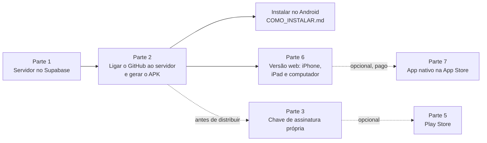

# Guia de deploy: colocar o app no ar

Este guia leva o projeto do código até o app funcionando no **Android** (APK), no **iPhone e no computador** (versão web instalável), **sem programar**. Tudo é feito pelo navegador, nos painéis do Supabase e do GitHub. A única parte que usa o terminal é opcional (chave de assinatura própria, parte 3).



| Parte | O que é | Tempo aproximado | Obrigatória? |
|---|---|---|---|
| 1 | Criar ou reativar o servidor e criar as tabelas | 20 a 30 min | Sim |
| 2 | Informar o endereço do servidor ao GitHub e gerar o APK | 5 min + 20 min de espera | Sim |
| 3 | Chave de assinatura própria | 15 min | Antes de distribuir para mais pessoas |
| 4 | Lançar novas versões | 5 min | Quando houver mudanças |
| 5 | Google Play Store | Dias (análise do Google) | Opcional |
| 6 | Versão web (iPhone, iPad, computador, qualquer sistema) | 2 min + 5 min de espera | Para quem não usa Android |
| 7 | App nativo para iPhone (App Store) | Dias (análise da Apple) | Opcional, pago |
| 8 | Voltar atrás (rollback) | Conforme o caso | Se algo der errado |

> **Nunca** cole em lugar nenhum do GitHub (código, issues, comentários) a senha do banco, a chave `secret`/`service_role` do Supabase ou a senha da chave de assinatura. Os únicos lugares certos para segredos são os **Secrets** do GitHub (parte 3) e o seu gerenciador de senhas. Detalhes em [SEGURANCA.md](SEGURANCA.md).

## Parte 1: servidor (Supabase)

O Supabase guarda as contas, as agendas e os eventos. O plano gratuito basta para começar.

### 1.1 Liberar uma vaga de projeto (situação atual da sua conta)

O plano gratuito permite **2 projetos ativos** por pessoa. Sua conta já tem 2 projetos ativos em outras organizações, e por isso o projeto deste app (**"GustavoOliveira-xxx's Project"**, região São Paulo) está pausado e não pôde ser reativado automaticamente.

1. Entre em <https://supabase.com/dashboard> com a sua conta.
2. Na lista de projetos, troque de organização (seletor no topo) para encontrar os 2 projetos ativos.
3. Em um projeto que você **não usa mais**: abra o projeto > **Project Settings** > **General** > **Pause project** (pausar não apaga nada; dá para reativar depois). Se tiver certeza de que não precisa dele, pode excluir em **Delete project**.
4. Volte à lista e abra o projeto **"GustavoOliveira-xxx's Project"** > botão **Restore project**. Aguarde alguns minutos até o status ficar verde ("Healthy").

**Alternativa:** em vez de reativar o projeto antigo, crie um novo: **New project** > nome `agenda-compartilhada` > região **South America (São Paulo)** > crie uma senha forte para o banco e **guarde no seu gerenciador de senhas** (não cole no GitHub). O plano é **Free**.

> O projeto antigo foi criado em julho de 2026 e pode ter tabelas de testes anteriores. Depois de reativar, abra **Table Editor**: se aparecerem tabelas como `calendars` ou `events` de outro teste, prefira criar um projeto novo, porque os scripts do passo 1.2 esperam um banco limpo.

### 1.2 Criar as tabelas (aplicar as migrations)

"Migrations" são os arquivos SQL que criam o banco. São 6 e precisam ser aplicados **em ordem**.

1. No GitHub, abra a pasta [`supabase/migrations`](supabase/migrations).
2. No painel do Supabase, abra **SQL Editor** (menu da esquerda) > **New query**.
3. Para cada arquivo, nesta ordem:

   | Ordem | Arquivo | O que cria |
   |---|---|---|
   | 1 | `20261020000100_base.sql` | Perfis, preferências, aparelhos, limites de tentativas |
   | 2 | `20261020000200_calendars.sql` | Agendas, membros, convites e a "Minha agenda" automática |
   | 3 | `20261020000300_events.sql` | Eventos, exceções de recorrência, participantes, lembretes, comentários |
   | 4 | `20261020000400_activity_notifications.sql` | Histórico, avisos e auditoria |
   | 5 | `20261020000500_rpc.sql` | Funções usadas pelo app (convites, eventos, exportação, exclusão de conta) |
   | 6 | `20261020000600_security.sql` | Regras de acesso (RLS) e permissões |

   a. No GitHub, abra o arquivo e clique no botão **Copy raw file** (ícone de duas folhas, no canto superior direito do código).
   b. No SQL Editor, apague o que houver, cole (Ctrl+V) e clique em **Run** (ou Ctrl+Enter).
   c. **Resultado esperado:** "Success. No rows returned".
   d. Se aparecer erro: anote a mensagem, **não pule** para o próximo arquivo e veja [TROUBLESHOOTING.md](TROUBLESHOOTING.md#erro-ao-aplicar-as-migrations).

4. Confira: **Table Editor** deve listar tabelas como `profiles`, `calendars`, `calendar_members`, `invitations` e `events`, cada uma com o selo de "RLS enabled".

**Alternativas para quem programa:** `npx supabase link --project-ref SEU_REF` e `npx supabase db push` na raiz do projeto (pede a senha do banco no terminal; não a salve em arquivos).

**Dados de demonstração (opcional, só para projeto de testes):** o arquivo [`supabase/seed.sql`](supabase/seed.sql) cria 4 pessoas fictícias (`ana.demo@exemplo.test` e outras) com a senha `Demo@2026!`, uma agenda compartilhada, eventos passados, futuros, recorrentes, privados e cancelados, lembretes, comentários e histórico. Ele só roda em banco **sem nenhum usuário**. **Não use em produção**: a senha das contas de demonstração é pública.

### 1.3 Configurar o login (Authentication)

No painel, abra **Authentication**:

1. **Sign In / Providers > Email:**
   - **Confirm email:** para começar com um grupo pequeno, **desligue**. Motivo: sem um servidor de e-mail próprio (SMTP), o Supabase só envia e-mails para membros da equipe do projeto, e as outras pessoas não receberiam o código. Ligue depois de configurar o SMTP (passo 1.4).
   - **Minimum password length:** `8` (o app já exige letras e números).
   - Salve.
2. **Sign In / Providers > User Signups:** deixe **Allow new users to sign up** ligado enquanto as pessoas criam conta. Se quiser fechar o app só para quem já tem conta, desligue depois.

### 1.4 E-mails: códigos de confirmação e de recuperação de senha

O app trabalha com **códigos de 6 dígitos** digitados no próprio app (não usa links). Por isso os modelos de e-mail precisam conter `{{ .Token }}`.

1. **Authentication > Emails > Templates:**
   - **Confirm signup:** assunto "Seu código de confirmação"; corpo: copie o conteúdo de [`supabase/templates/confirmacao.html`](supabase/templates/confirmacao.html).
   - **Reset password:** assunto "Código para redefinir sua senha"; corpo: copie [`supabase/templates/recuperacao.html`](supabase/templates/recuperacao.html).
   - Salve cada um.
2. **SMTP próprio (recomendado para recuperação de senha funcionar para todos):** **Authentication > Emails > SMTP Settings** > ative **Enable custom SMTP** e preencha com os dados de um provedor de e-mail. Opções com plano gratuito para volume baixo: Resend, Brevo (confira os limites atuais no site de cada um). Esses dados ficam **só no painel do Supabase**.

Sem SMTP próprio, "Esqueci minha senha" só funciona para e-mails da equipe do projeto. Quem esquecer a senha pode ser ajudado pelo responsável em **Authentication > Users** (botão de enviar recuperação ou excluir o usuário para recriar).

### 1.5 Pegar o endereço e a chave pública

1. **Project Settings > Data API** (ou o botão **Connect** no topo): copie a **Project URL** (ex.: `https://abcd1234.supabase.co`).
2. **Project Settings > API Keys:** copie a **Publishable key** (começa com `sb_publishable_`). Em projetos antigos, a equivalente é a chave **anon** (aba "Legacy API keys").

Essas duas informações são **públicas por natureza**: vão dentro do APK. Quem protege os dados são as regras de acesso do banco. **Nunca** use a chave `secret` ou `service_role` no app nem no GitHub.

### 1.6 Conferir a segurança

Abra **Advisors > Security Advisor** e clique em **Rerun**. O esperado é não haver alertas de nível **ERROR**. Avisos sobre configurações do Auth (por exemplo, proteção contra senhas vazadas, que é paga) podem aparecer; leia e decida. Se surgir algo sobre tabelas sem RLS, as migrations não foram aplicadas por completo: refaça o passo 1.2.

### 1.7 Limpeza automática da lixeira (opcional)

Itens na lixeira deveriam ser apagados após 30 dias. Para automatizar:

1. **Integrations > Cron** > ative a extensão (**pg_cron**).
2. **Create job:** nome `limpar-lixeira`, agenda `0 4 * * *` (todo dia às 4h UTC), tipo **SQL snippet**, comando:

   ```sql
   select public.purge_trash(30);
   ```

Sem isso, os itens continuam na lixeira (ocupando pouco espaço) até alguém rodar o comando no SQL Editor.

### 1.8 Cuidados com o plano gratuito

- Projetos gratuitos são **pausados após cerca de 7 dias sem uso**. Quando isso acontece, o app mostra "Sem conexão com o servidor". Para voltar: painel > projeto > **Restore project**. Os dados são mantidos.
- Faça uma cópia dos dados de vez em quando (o plano gratuito não oferece download de backups):
  - **Sem programar:** **Table Editor** > abra cada tabela > **Export** > **Export to CSV**.
  - **Para quem programa:** `pg_dump` com a connection string do botão **Connect** (a senha do banco é pedida na hora), ou `npx supabase db dump --linked --data-only -f backup.sql` (precisa do Docker instalado).
  - Guarde a cópia **fora da pasta do projeto** e nunca no GitHub: ela contém dados pessoais.

## Parte 2: ligar o GitHub ao servidor

O GitHub Actions gera o APK. Ele precisa saber o endereço do servidor.

### 2.1 Cadastrar as Variables

1. No GitHub, abra o repositório > **Settings** > **Secrets and variables** > **Actions**.
2. Aba **Variables** > **New repository variable**:

   | Name | Value |
   |---|---|
   | `EXPO_PUBLIC_SUPABASE_URL` | A Project URL do passo 1.5 |
   | `EXPO_PUBLIC_SUPABASE_ANON_KEY` | A Publishable key (ou anon) do passo 1.5 |

Use a aba **Variables** (não Secrets) para essas duas: elas não são secretas e assim ficam visíveis para conferência.

### 2.2 Gerar e publicar o APK

1. Aba **Actions** > na lista da esquerda, **Gerar APK Android**.
2. Botão **Run workflow** (à direita) > em "Use workflow from", escolha a branch principal do projeto > deixe marcado **Publicar o APK na página Releases** > **Run workflow**.
3. Aguarde cerca de **20 minutos**. Você pode fechar a página.

**Como saber se deu certo:**

- **Bolinha verde (✓)** ao lado da execução: build aprovada. O APK estará em **Releases** (página inicial do repositório, coluna da direita) com instruções de instalação.
- **Aviso amarelo "Servidor não configurado":** as Variables do passo 2.1 estão faltando ou com outro nome. O APK é gerado, mas abre na tela "Servidor não configurado".
- **Aviso "Chave de testes":** normal enquanto você não fizer a parte 3. A release fica marcada como "Pre-release".
- **X vermelho:** clique na execução > clique no passo com X para ver o erro > veja [TROUBLESHOOTING.md](TROUBLESHOOTING.md#github-actions).

**Onde mais baixar:** cada execução (inclusive as automáticas, que rodam quando o código do app muda) guarda o APK e o AAB por 30 dias em **Actions > execução > Artifacts** (precisa estar logado no GitHub). A página **Releases** é melhor para mandar o link a outras pessoas.

### 2.3 Instalar e testar

Siga o [COMO_INSTALAR.md](COMO_INSTALAR.md). Depois, use o roteiro de teste manual de [docs/TESTES.md](docs/TESTES.md) com duas contas (por exemplo, você e outra pessoa) para conferir convites, permissões e sincronização.

## Parte 3: chave de assinatura própria

Todo APK é "assinado" por uma chave. O Android só aceita **atualizar** um app se a nova versão tiver a **mesma assinatura**. Sem configurar nada, o workflow usa a **chave de testes** do Android, que é pública (qualquer pessoa poderia gerar um APK "atualização" falso). Para distribuir de verdade, crie a sua.

**Faça isso antes de distribuir para muitas pessoas.** Quem instalou a versão de testes precisará desinstalar e instalar a versão com a chave nova uma única vez.

### 3.1 Criar a chave (uma vez na vida do app)

Precisa de um computador com Java. O jeito mais simples é instalar o [Android Studio](https://developer.android.com/studio), que já traz o programa `keytool`.

**Windows (PowerShell),** em uma pasta **fora** do projeto (por exemplo, Documentos):

```powershell
# Pasta: Documentos (fora do repositório)
# Finalidade: criar o arquivo da chave de assinatura
& "C:\Program Files\Android\Android Studio\jbr\bin\keytool.exe" -genkeypair -v -storetype PKCS12 -keystore agenda-release.jks -alias agenda -keyalg RSA -keysize 2048 -validity 10000
```

**macOS ou Linux:**

```bash
# Pasta: sua pasta pessoal (fora do repositório)
keytool -genkeypair -v -storetype PKCS12 -keystore agenda-release.jks -alias agenda -keyalg RSA -keysize 2048 -validity 10000
```

- O programa pede uma **senha** (crie uma forte e guarde no gerenciador de senhas) e dados como nome e cidade (podem ser genéricos).
- **Resultado esperado:** o arquivo `agenda-release.jks` criado na pasta.
- **Se falhar** com "keytool não é reconhecido": confira o caminho do Android Studio (pode estar em outra pasta) ou instale o Java (Temurin 17).

### 3.2 Guardar a chave com segurança

- Faça **duas cópias** do `agenda-release.jks` em lugares seguros e diferentes (pendrive guardado, cofre de senhas que aceite arquivos).
- **Se perder a chave ou a senha, não será mais possível atualizar o app** com a mesma assinatura (as pessoas teriam de desinstalar e instalar de novo).
- **Nunca** coloque o `.jks` na pasta do projeto nem no GitHub. O `.gitignore` bloqueia `*.jks` e `*.keystore` e o workflow Qualidade procura chaves no código, mas a melhor proteção é nem copiar para lá.

### 3.3 Transformar a chave em texto (base64)

O GitHub só guarda texto nos Secrets.

```powershell
# Windows (PowerShell), na pasta onde está o .jks
[Convert]::ToBase64String([IO.File]::ReadAllBytes("$PWD\agenda-release.jks")) | Set-Content agenda-release.b64
```

```bash
# Linux
base64 -w0 agenda-release.jks > agenda-release.b64
# macOS
base64 -i agenda-release.jks -o agenda-release.b64
```

Abra o `agenda-release.b64` no Bloco de Notas e copie todo o conteúdo (uma linha longa). **Apague o `.b64` depois** de cadastrar o Secret.

### 3.4 Cadastrar os Secrets no GitHub

Repositório > **Settings** > **Secrets and variables** > **Actions** > aba **Secrets** > **New repository secret**:

| Name | Value |
|---|---|
| `ANDROID_KEYSTORE_BASE64` | O conteúdo do `.b64` |
| `ANDROID_KEYSTORE_PASSWORD` | A senha criada no passo 3.1 |
| `ANDROID_KEY_ALIAS` | `agenda` (o valor de `-alias`) |
| `ANDROID_KEY_PASSWORD` | A mesma senha do passo 3.1 (chaves PKCS12 usam uma senha só) |

Secrets nunca aparecem de novo depois de salvos, nem nos registros do Actions. Rode a parte 2.2 de novo: a release deixa de ser "Pre-release" e o registro mostra "Assinatura: chave própria".

## Parte 4: lançar novas versões

1. Quem programa altera o código e atualiza o [CHANGELOG.md](CHANGELOG.md).
2. Se a mudança for visível para as pessoas, aumente a versão em `app-mobile/app.json` (`"version": "1.0.0"` para `"1.1.0"`, por exemplo).
3. O **número da compilação** (versionCode) é automático: é o número da execução do workflow. Ele sempre cresce, o que o Android exige para aceitar a atualização.
4. Gere a release pela parte 2.2. Alternativa para quem usa Git: criar uma tag `v1.1.0` e enviar (`git tag v1.1.0 && git push origin v1.1.0`); o workflow publica a release sozinho.
5. **Se a versão mudar o banco** (nova migration em `supabase/migrations`): faça um backup (1.8) e aplique a nova migration no SQL Editor **antes** de distribuir o APK novo.

## Parte 5: Google Play Store

O arquivo para a loja é o **`.aab`** (gerado junto com o APK). A publicação exige:

| Requisito | Observação |
|---|---|
| Conta de desenvolvedor | <https://play.google.com/console>, taxa única (US$ 25 na data deste guia) e verificação de identidade |
| Informações do app | Nome, descrição curta e completa, categoria (Produtividade), contato |
| Ícone | 512 x 512 px (pode ser gerado a partir de `app-mobile/assets/images/icon.png`) |
| Imagens | Capturas de tela do celular (mínimo 2) e imagem de destaque 1024 x 500 px |
| Política de privacidade | Precisa de um link público. Revise [POLITICA_DE_PRIVACIDADE.md](POLITICA_DE_PRIVACIDADE.md) (é um modelo técnico, defina o e-mail de contato) e publique, por exemplo, pelo GitHub Pages |
| Classificação etária | Questionário no Play Console (o app não tem conteúdo sensível) |
| Segurança dos dados | Declarar: nome, e-mail e conteúdo criado pela pessoa; criptografia em trânsito; exclusão de conta disponível no app; sem anúncios e sem compartilhamento com terceiros para publicidade |
| Versão assinada | O `.aab` assinado com a sua chave (parte 3) vira a "chave de upload"; o Google assina a versão final (Play App Signing) |
| Declarações | Anúncios (não), público-alvo (maiores de 18), acesso para análise (crie uma conta de teste para o revisor do Google) |
| Testes | Contas pessoais novas precisam de um **teste fechado** com um número mínimo de testadores por alguns dias antes de liberar para todos (na data deste guia: 12 testadores por 14 dias; confira no Play Console) |

Observação: o app instalado pela loja terá a assinatura do Google, diferente do APK do GitHub. Quem migrar do APK para a loja precisa desinstalar antes.

## Parte 6: versão web (iPhone, iPad, computador e qualquer sistema)

O mesmo app roda no navegador e pode ser **instalado na tela de início**, com ícone próprio, em tela cheia e abrindo mesmo sem internet. Funciona no iPhone, iPad, Android, Windows, Mac e Linux. É **gratuito**: o site fica no GitHub Pages, junto deste repositório. A tela se adapta ao tamanho: no celular, abas embaixo; no tablet e no computador, menu lateral e calendário em duas colunas.

> **Por que não um app de iPhone "de verdade"?** Para instalar um app nativo no iPhone de outras pessoas, a Apple exige uma conta paga de desenvolvedor (parte 7). A versão web resolve sem custo e com o mesmo código.

### 6.1 Ligar o GitHub Pages (uma vez só)

1. No GitHub, abra o repositório > **Settings** > **Pages** (menu da esquerda).
2. Em **Build and deployment** > **Source**, escolha **GitHub Actions**.

Não precisa salvar nada mais: a escolha já vale.

### 6.2 Publicar o site

1. Confira se as Variables da parte 2.1 estão cadastradas (o site usa as mesmas do APK).
2. Aba **Actions** > **Publicar versão web** > **Run workflow** > **Run workflow**.
3. Em cerca de 5 minutos o site estará em:

   **<https://gustavooliveira-xxx.github.io/synck-app/>**

   O endereço também aparece no resumo da execução, no quadro **Publicar no GitHub Pages**.

Depois disso, toda mudança no app enviada para a branch principal **publica o site sozinha**. Antes de publicar, o workflow testa se o site abre, se pode ser instalado e se funciona sem internet; se algum teste falhar, a versão antiga continua no ar.

**Como saber se deu certo:** bolinha verde nos dois quadros (**Gerar e testar o site** e **Publicar no GitHub Pages**). Se aparecer o aviso **"GitHub Pages desligado"**, refaça o passo 6.1 e rode o workflow de novo.

### 6.3 Instalar na tela de início

Mande o endereço para as pessoas. O passo a passo para cada aparelho (iPhone, Android e computador) está no [COMO_INSTALAR.md, opção C](COMO_INSTALAR.md#opção-c-iphone-ipad-computador-ou-qualquer-celular-versão-web).

### 6.4 Diferenças em relação ao app Android

| Recurso | App Android (APK) | Versão web (iPhone e computador) |
|---|---|---|
| Agendas, eventos, convites, permissões | Sim | Sim, igual |
| Abrir sem internet e editar offline | Sim | Sim, depois do primeiro acesso |
| Atualização automática com mudanças de outras pessoas | Sim | Sim |
| **Lembretes que tocam no horário** | Sim | **Não** nesta versão (ficam salvos, mas não tocam; ver [ROADMAP.md](ROADMAP.md)) |
| Onde a sessão fica guardada | Cofre do Android | Armazenamento do navegador ([SEGURANCA.md](SEGURANCA.md)) |
| Atualizações | Baixar o APK novo | Automáticas (ao abrir o app) |

### 6.5 Domínio próprio e outros serviços (opcional)

- **Domínio próprio** (ex.: `agenda.seudominio.com.br`): Settings > Pages > **Custom domain**. O workflow percebe sozinho e passa a gerar o site na raiz do domínio.
- **Netlify, Vercel ou Cloudflare Pages** também servem (planos gratuitos). Gere o site com `npx expo export --platform web` na pasta `app-mobile` (as Variables do Supabase como variáveis de ambiente) e configure o serviço para devolver o `index.html` em qualquer endereço. O GitHub Pages foi escolhido por já estar junto do código ([DECISOES.md, D24](DECISOES.md#d24-versão-web-instalável-para-iphone-e-computadores)).

## Parte 7: app nativo para iPhone (App Store)

O código é compatível com iOS (Expo), mas **nenhuma versão nativa para iPhone foi gerada nem testada** neste projeto. Só faça isto se quiser o app na App Store; para usar no iPhone, a parte 6 já basta.

**O que é preciso:**

- **Apple Developer Program**: anuidade de US$ 99 na data deste guia. Sem ela, a Apple não permite instalar um app nativo no iPhone de outras pessoas.
- Uma conta gratuita na **Expo** (<https://expo.dev>). O serviço **EAS Build** compila o app na nuvem e cuida dos **certificados** e dos **provisioning profiles** (perfis que dizem quem pode instalar o app). **Não precisa de Mac.** A cota gratuita de builds é limitada; confira no site.

**Passo a passo (no computador, pasta `app-mobile`, com Node.js instalado):**

```bash
# 1. Entrar na conta da Expo e ligar o projeto a ela (grava o id do projeto no app.json; faça commit depois)
npx eas-cli@latest login
npx eas-cli@latest init

# 2. Gerar o app de iPhone na nuvem (pede o login da Apple na primeira vez e cria os certificados)
npx eas-cli@latest build --platform ios

# 3. Enviar para o App Store Connect (a versão aparece no TestFlight)
npx eas-cli@latest submit --platform ios
```

4. **TestFlight**: no App Store Connect, adicione testadores; eles instalam o app **TestFlight** no iPhone e recebem o convite.
5. **App Store**: preencha a ficha (descrição, capturas de tela do iPhone, política de privacidade com link público, questionário de privacidade) e envie para análise. A Apple exige que a exclusão de conta exista **dentro do app**: isso já está pronto (Perfil > Privacidade e dados).

O identificador do app para iOS já está em `app-mobile/app.json` (`com.gustavooliveira.agendacompartilhada`), e o app já aceita iPad e telas deitadas. Antes de publicar, rode o roteiro de [docs/TESTES.md](docs/TESTES.md) num iPhone pelo TestFlight, principalmente lembretes e login.

## Parte 8: voltar atrás (rollback)

| Situação | O que fazer |
|---|---|
| APK novo com problema | Na página Releases, marque a release ruim como "Pre-release" ou exclua-a, para ninguém mais baixar. O Android não deixa instalar uma versão **mais antiga** por cima: quem precisar voltar desinstala e instala o APK anterior (os dados estão no servidor; alterações offline não enviadas se perdem). Melhor caminho: corrigir e gerar uma versão nova. |
| Migration nova quebrou algo | As migrations não têm "desfazer" automático. Restaure o backup do passo 1.8 em um projeto novo, ou escreva uma migration de correção. Por isso o backup antes de cada mudança no banco. |
| Site (versão web) com problema | Aba Actions > Publicar versão web: rode o workflow de novo a partir de um commit anterior (Run workflow > escolha a branch ou tag), ou desfaça o commit com problema. As pessoas recebem a correção ao abrir o app de novo. |
| Configuração errada do Auth | Volte a chave no painel; nada no app precisa mudar. |
| Chave pública exposta em lugar estranho | Ela já é pública por natureza; ainda assim, o procedimento de troca está em [SEGURANCA.md](SEGURANCA.md#procedimento-para-revogar-credenciais-expostas). |
| Chave `secret`/`service_role`, senha do banco ou keystore vazada | Siga [SEGURANCA.md](SEGURANCA.md#procedimento-para-revogar-credenciais-expostas) imediatamente. |

## Parte 9: entrar com Google

O app já tem o botão **Entrar com Google** (na abertura, no login e no cadastro). Ele só funciona depois destes passos, feitos uma vez. Enquanto não estiverem feitos, o botão avisa que a entrada com Google ainda não foi ativada e o e-mail com senha continua funcionando normalmente. **Não custa nada.**

As chaves do Google ficam só no painel do Supabase. Não cole nenhuma delas no GitHub, no código nem em conversas.

**9.1 Criar o acesso no Google (Google Cloud)**

1. Entre em <https://console.cloud.google.com> com sua conta Google.
2. No topo, **Selecionar projeto > Novo projeto** > nome `SynCK` > **Criar**. Confira se o projeto `SynCK` está selecionado no topo.
3. Menu (☰) > **APIs e serviços > Tela de consentimento OAuth** (em algumas contas aparece como **Google Auth Platform > Branding**):
   - Nome do app: `SynCK`. E-mail de suporte: o seu.
   - Público (Audience): **Externo**.
   - Contato do desenvolvedor: o seu e-mail. Salve.
   - Em **Público**, toque em **Publicar app** (sem isso, só contas de teste conseguem entrar).
4. Menu > **APIs e serviços > Credenciais > Criar credenciais > ID do cliente OAuth**:
   - Tipo de aplicativo: **Aplicativo da Web**. Nome: `SynCK`.
   - **Origens JavaScript autorizadas:** `https://gustavooliveira-xxx.github.io`
   - **URIs de redirecionamento autorizados:** `https://rirzumnfpsdqpubvvckh.supabase.co/auth/v1/callback`
   - **Criar.** Aparecem o **ID do cliente** e a **Chave secreta do cliente**. Deixe essa janela aberta.

**9.2 Ligar o Google no Supabase**

1. Em <https://supabase.com/dashboard>, abra o projeto > **Authentication > Sign In / Providers > Google**.
2. Ative **Enable Sign in with Google**, cole o **Client ID** e o **Client Secret** do passo anterior e toque em **Save**.
3. **Authentication > URL Configuration > Redirect URLs > Add URL**, uma de cada vez:
   - `https://gustavooliveira-xxx.github.io/synck-app/`
   - `agendacompartilhada://auth/callback`
4. **Save.**

**9.3 Testar**

- No computador: abra o site, toque em **Entrar com Google**, escolha a conta. O app volta já logado na tela Hoje.
- No Android (APK 2.0.0 ou mais novo): o Google abre numa janela do navegador e, ao escolher a conta, volta para o SynCK.
- A primeira entrada com Google cria a conta com o nome do Google. Se a pessoa já tinha conta com o mesmo e-mail (cadastro com senha), o Supabase junta as duas.

## Parte 10: notificações no iPhone e no computador

Já está ativado no servidor (função `enviar-push` e o agendamento que roda a cada minuto). Não há nada para configurar nem pagar.

**Para cada pessoa:**

- **Computador (Chrome, Edge, Firefox, Safari):** abra o site > **Perfil > Notificações > Notificações neste navegador** > permita quando o navegador perguntar.
- **iPhone e iPad (iOS 16.4 ou mais novo):** primeiro adicione o SynCK à Tela de Início (Safari > Compartilhar > **Adicionar à Tela de Início**), abra pelo ícone e então ative em **Perfil > Notificações**. A Apple só entrega notificações para sites adicionados à Tela de Início.

**O que chega:** os lembretes de cada evento (mesmo horário do Android, com "Em 30 min: ...") e os avisos (evento criado, alterado ou cancelado, convite, comentário, pessoa entrando na agenda). Ao tocar, o SynCK abre direto no evento. O horário de silêncio e a opção "Mostrar detalhes na tela bloqueada" valem aqui também.

**Como funciona:** cada navegador que ativa gera uma inscrição (tabela `push_subscriptions`). O agendamento `synck-enviar-push` (pg_cron) chama a função `enviar-push` a cada minuto; ela calcula os lembretes que venceram com a mesma lógica do app (cópia em `supabase/functions/enviar-push/logica`, conferida pelo CI) e envia pelo padrão Web Push. As chaves desse envio são criadas pela própria função e ficam só no banco.

**Android com o app fechado:** os lembretes já tocam (são agendados no próprio celular). Os **avisos de outras pessoas** com o app fechado exigiriam o Firebase Cloud Messaging (conta no Firebase e um arquivo de configuração no APK). Ficou como passo opcional no [ROADMAP.md](ROADMAP.md); hoje eles aparecem no sino da tela Hoje assim que o app abre.

**Atualizar a função depois de mudar o código:** com o [Supabase CLI](https://supabase.com/docs/guides/cli) logado, na raiz do projeto: `npx supabase functions deploy enviar-push --project-ref rirzumnfpsdqpubvvckh`. Antes, rode `node scripts/copiar-logica-push.mjs` se mexeu em datas, repetição ou lembretes do app.

## Custos

Com o uso previsto (grupos pequenos), **tudo pode ficar no gratuito**. Valores e limites na data deste guia; confira nos sites.

| Serviço | Gratuito | Quando passa a custar |
|---|---|---|
| Supabase | Plano Free: 2 projetos ativos, banco de 500 MB, pausa após cerca de 7 dias sem uso | Mais projetos, mais espaço, sem pausa e com backups: plano Pro (mensal) |
| GitHub (repositório público) | Actions e Pages gratuitos para repositórios públicos | Repositório privado tem cota mensal de minutos |
| E-mail (SMTP) | Planos gratuitos com limite diário | Volumes maiores |
| Google Play | Não | Taxa única de cadastro |
| Apple | Não (a versão web no iPhone é gratuita) | Anuidade, só para o app nativo na App Store |

O app **não usa nenhum serviço pago** sem aviso; nenhuma etapa deste guia exige cartão de crédito, exceto as partes 5 e 7.
