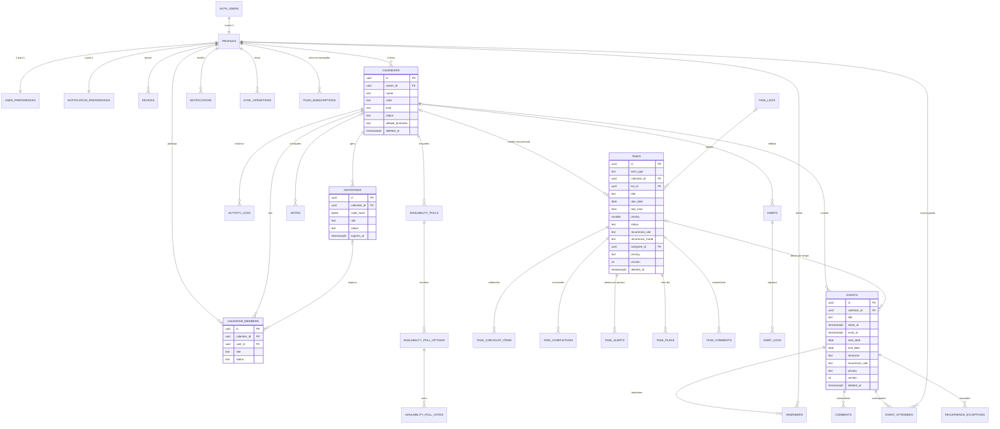

# Modelo de dados

Banco: **PostgreSQL 17** (Supabase). Scripts em [`supabase/migrations/`](supabase/migrations), aplicados em ordem pelo nome:

| Arquivo | Conteúdo |
|---|---|
| `20261020000100_base.sql` | Esquema `private`, funções auxiliares, limite de requisições, perfis, preferências, dispositivos |
| `20261020000200_calendars.sql` | Agendas, membros, convites, gatilhos de cadastro e proteção |
| `20261020000300_events.sql` | Eventos, participantes, exceções, lembretes, comentários, operações de sincronização |
| `20261020000400_activity_notifications.sql` | Histórico, avisos, auditoria e gatilhos que os alimentam |
| `20261020000500_rpc.sql` | Funções chamadas pelo app |
| `20261020000600_security.sql` | Regras RLS, permissões de tabela e coluna, tempo real |
| `20261022000700_synck.sql` | Versão 2.0: confirmação de presença, inscrições de notificação no navegador e configuração do envio |
| `20261023000800_tarefas.sql` | Versão 3.0: tarefas e lembretes, listas, subtarefas, conclusões, alertas, plano do dia, anotações, hábitos, enquetes de horário, histórico de itens, disponibilidade e vínculo entre evento e tarefa |

## Diagrama ER



## Convenções

- Chaves primárias `uuid` (geradas pelo banco ou pelo app, no caso de eventos, para evitar duplicatas offline).
- Enumerações são `text` com `CHECK` (mais fáceis de evoluir).
- `created_at`/`updated_at` em todas as tabelas de conteúdo; `updated_at` mantido por gatilho.
- Exclusão lógica (`deleted_at`) em agendas, eventos e comentários.
- Todas as tabelas têm **RLS ligado**. O que cada pessoa vê está descrito em "Acesso".

## Tabelas

### `auth.users` (Supabase Auth)
**Finalidade:** contas de login. Gerenciada pelo Supabase: e-mail, hash bcrypt da senha, confirmação (`email_confirmed_at`), metadados. Substitui a tabela `users` sugerida (D16).

### `profiles`
**Finalidade:** dados mínimos visíveis a quem divide agenda com a pessoa.

| Campo | Tipo | Obrig. | Observação |
|---|---|:-:|---|
| `id` | uuid | ✓ | PK e FK para `auth.users` (exclusão em cascata) |
| `display_name` | text | ✓ | 1 a 80 caracteres |
| `avatar_color` | text | ✓ | `#RRGGBB` |
| `avatar_url` | text | | Reservado para foto (futuro) |
| `account_status` | text | ✓ | `active`, `suspended`, `pending_deletion` |
| `last_seen_at` | timestamptz | | Último acesso |
| `deletion_scheduled_at` | timestamptz | | Reservado para exclusão com carência (futuro) |
| `created_at`, `updated_at` | timestamptz | ✓ | |

**Acesso:** a pessoa lê o próprio perfil e o de quem divide agenda ativa; só as colunas `id, display_name, avatar_color, avatar_url, created_at` são legíveis pela API (o e-mail nunca aparece aqui). Atualiza só nome e cor do próprio perfil.

### `user_preferences`
**Finalidade:** preferências privadas (1 para 1 com perfil). Campos: `locale` (pt-BR), `timezone` (IANA, validado por gatilho), `use_device_timezone`, `date_format`, `time_format` (24h/12h), `theme` (system/light/dark), `week_starts_on` (0 domingo, 1 segunda). Na 3.0: `daily_checkin` (perguntar "O que você pretende fazer hoje?", padrão ligado), `day_start` e `day_end` (janela do dia usada nos horários livres e no planejador, padrão 08:00 a 22:00, fim depois do início) e `share_availability` (mostrar os horários ocupados das outras agendas ao procurar horário em comum, padrão desligado). **Acesso:** só a própria pessoa.

### `notification_preferences`
**Finalidade:** preferências de aviso. Campos: `enabled`, `quiet_hours_start/end` (ambos ou nenhum), `show_details_on_lock_screen` (padrão falso), `default_reminder_minutes`, `notify_invites`, `notify_event_changes`, `notify_member_changes`, `notify_comments`, `notify_reminders`, `notify_tasks` (3.0: tarefa atribuída, concluída ou comentada), `sound`, `vibration`. **Acesso:** só a própria pessoa.

### `devices`
**Finalidade:** aparelhos conectados (e, no futuro, token de push). Campos: `installation_id` (único por pessoa), `platform`, `device_name`, `os_version`, `app_version`, `push_token`, `last_seen_at`. Máximo de 20 por pessoa (os mais antigos saem). **Acesso:** ler e apagar os próprios; gravação via `register_device`.

### `calendars`
**Finalidade:** agendas.

| Campo | Tipo | Obrig. | Observação |
|---|---|:-:|---|
| `id` | uuid | ✓ | PK |
| `owner_id` | uuid | ✓ | FK `profiles` (restrict: a conta não é apagada com agenda compartilhada) |
| `name` | text | ✓ | 1 a 80 |
| `description` | text | | até 500 |
| `color` | text | ✓ | `#RRGGBB` |
| `icon` | text | | opcional |
| `kind` | text | ✓ | personal, shared, family, work, project, travel, custom |
| `status` | text | ✓ | active, archived |
| `visibility` | text | ✓ | private (único valor na V1) |
| `default_timezone` | text | ✓ | IANA |
| `default_member_role` | text | ✓ | papel sugerido em convites |
| `admins_can_invite`, `members_can_invite` | boolean | ✓ | configurações de convite |
| `editors_can_edit_all`, `allow_private_events` | boolean | ✓ | política de eventos |
| `conflict_policy` | text | ✓ | warn, block, ignore |
| `notify_members_on_changes` | boolean | ✓ | configuração de notificação |
| `archived_at`, `deleted_at` | timestamptz | | arquivamento e lixeira |

**Acesso:** membros ativos leem (o dono também vê na lixeira). Dono e administrador alteram configurações comuns; só o dono altera as exclusivas (gatilho). Arquivar/lixeira/excluir só pelo dono via `set_calendar_state`.

### `calendar_members`
**Finalidade:** relação pessoa x agenda (N para N).

| Campo | Tipo | Obrig. | Observação |
|---|---|:-:|---|
| `id` | uuid | ✓ | PK |
| `calendar_id`, `user_id` | uuid | ✓ | FKs; par único |
| `role` | text | ✓ | owner, admin, editor, collaborator, viewer |
| `status` | text | ✓ | active, removed, left |
| `joined_at`, `last_activity_at` | timestamptz | | |
| `granted_by`, `removed_by` | uuid | | quem concedeu / removeu |
| `invitation_id` | uuid | | convite de origem |
| `notifications_enabled` | boolean | ✓ | aviso individual por agenda |
| `removed_at` | timestamptz | | |

**Integridade:** índice único parcial garante **um proprietário ativo** por agenda. **Acesso:** membros da agenda leem; a pessoa só altera `notifications_enabled` da própria linha; papéis e status só por funções.

### `invitations`
**Finalidade:** convites. Campos: `calendar_id`, `created_by`, `invited_email` (minúsculo, opcional), `role`, `code_hash` (SHA-256, único), `code_hint` (4 últimos caracteres), `expires_at`, `max_uses`, `use_count`, `status`, `accepted_at`, `accepted_by`, `cancelled_at`, `cancelled_by`. Índice único parcial: um convite pendente por e-mail por agenda. **Acesso:** nenhum direto; tudo por funções.

### `events`
**Finalidade:** eventos (e séries recorrentes).

| Campo | Tipo | Obrig. | Observação |
|---|---|:-:|---|
| `id` | uuid | ✓ | PK (pode ser gerado no aparelho) |
| `calendar_id` | uuid | ✓ | FK (cascata); não pode mudar |
| `title` | text | ✓ | 1 a 150 |
| `description`, `location`, `address`, `url` | text | | limites 5000/200/300/2048; URL http(s) |
| `all_day` | boolean | ✓ | |
| `starts_at`, `ends_at` | timestamptz | ✓ | instantes UTC; fim > início; até 366 dias |
| `start_date`, `end_date` | date | dia inteiro | datas locais |
| `timezone` | text | ✓ | IANA |
| `recurrence_rule` | text | | RRULE (subconjunto validado por regex) |
| `created_by`, `updated_by`, `assignee_id` | uuid | | FK `profiles` (set null) |
| `color` | text | | cor própria (senão, a da agenda) |
| `event_type` | text | ✓ | appointment, meeting, task, reminder, birthday, travel, holiday, social, work, custom |
| `status` | text | ✓ | planned, confirmed, completed, cancelled, postponed, archived |
| `privacy` | text | ✓ | members, participants, private, busy |
| `version` | integer | ✓ | controle de concorrência (gatilho incrementa) |
| `change_origin` | text | ✓ | app, offline_sync, system |
| `completed_at`, `deleted_at` | timestamptz | | |
| `task_id` | uuid | | 3.0: bloco de tempo reservado para uma tarefa (FK `tasks`, set null) |
| `external_uid` | text | | 3.0: identificador do evento no arquivo .ics importado; único por agenda |

Os tipos `task` e `reminder` continuam válidos para eventos criados na 2.0, mas o app não os oferece mais ao criar evento: tarefas e lembretes têm tabela própria.

**Índices:** (`calendar_id`, `starts_at`, `ends_at`) sem excluídos; séries recorrentes por agenda; `created_by`. **Acesso:** ver seção "Privacidade" em [DECISOES.md](DECISOES.md#d11-privacidade-de-eventos).

### `recurrence_exceptions`
**Finalidade:** alterações ou cancelamentos de uma ocorrência. Chave única (`event_id`, `original_date`). Campos de substituição opcionais: `title`, `description`, `location`, `starts_at`/`ends_at` (ambos ou nenhum). Substitui as tabelas planejadas `event_recurrences` + `recurrence_exceptions` (D16).

### `event_attendees`
**Finalidade:** participantes escolhidos. PK (`event_id`, `user_id`); `response` (pending, accepted, declined, tentative). Participante precisa ser membro ativo.

### `reminders`
**Finalidade:** lembretes pessoais. Único (`event_id`, `user_id`, `minutes_before`); 0 a 40.320 minutos; até 5 por evento por pessoa. **Acesso:** só os próprios.

### `comments`
**Finalidade:** comentários em eventos. `body` até 2.000 caracteres (caracteres de controle removidos), `edited_at`, `deleted_at`. **Acesso:** quem vê o evento por completo lê; colaborador ou acima comenta; autor edita; autor ou administração apaga.

### `sync_operations`
**Finalidade:** idempotência da sincronização. PK = id da operação; guarda só `{status, código, event_id, versão}`. Retenção: 30 dias.

### `activity_logs`
**Finalidade:** histórico visível. `action` (lista fechada), `details` (jsonb sem dados privados), `visibility` (members/admins). Retenção: enquanto a agenda existir.

### `notifications`
**Finalidade:** central de avisos dentro do app. `type`, `title`, `body`, `data`, `read_at`. Retenção: lidos são apagados após 90 dias pela manutenção.

### `audit_logs`
**Finalidade:** auditoria interna (ações administrativas). Sem acesso pela API; leitura só no painel do Supabase.

### `private.rate_limit_hits`
**Finalidade:** contador de tentativas para limite de requisições. Esquema não exposto. Retenção: 1 dia.

### `push_subscriptions` (2.0)
**Finalidade:** navegadores em que a pessoa ligou as notificações (iPhone e computador). `endpoint` (único, https), `p256dh`, `auth`, `user_agent`, `last_success_at`. Inscrições que o navegador recusa (404 ou 410) são apagadas no envio. **Acesso:** ler e apagar as próprias; gravação via `register_push_subscription`.

### `private.web_push_config` (2.0)
**Finalidade:** uma linha só com as chaves VAPID (criadas pela função de envio na primeira rodada), o segredo do agendamento, o endereço da função e a hora da última rodada. Esquema não exposto: a chave privada nunca sai do banco.

## Tabelas da versão 3.0

Todas com RLS ligado e **só leitura** pela API. Toda escrita passa por `apply_item_op` ou pelas funções específicas (comentários, enquetes), que conferem a permissão de cada operação (DECISOES.md, D31). Itens sem agenda (`calendar_id` vazio) são **pessoais**: só quem criou vê, mesmo dividindo outras agendas.

### `tasks`
**Finalidade:** tarefas e lembretes avulsos (D30).

| Campo | Tipo | Obrig. | Observação |
|---|---|:-:|---|
| `id` | uuid | ✓ | PK (pode ser gerado no aparelho) |
| `item_type` | text | ✓ | `task` ou `reminder` |
| `calendar_id` | uuid | | agenda (cascata); vazio = pessoal |
| `list_id` | uuid | | lista; precisa ser da mesma agenda |
| `title` | text | ✓ | 1 a 200 |
| `description` | text | | até 5.000 |
| `links`, `tags` | text[] | ✓ | até 5 links http(s) e 10 etiquetas (minúsculas, sem `#`) |
| `start_date`, `due_date` | date | | início não depois do prazo |
| `due_time` | time | | só com `due_date` |
| `timezone` | text | ✓ | IANA |
| `estimated_minutes` | integer | | 5 a 1.440 |
| `priority` | smallint | ✓ | 0 sem, 1 baixa, 2 média, 3 alta, 4 urgente |
| `status` | text | ✓ | pending, in_progress, waiting, done, cancelled |
| `recurrence_rule` | text | | RRULE (mesmo subconjunto dos eventos); exige prazo |
| `recurrence_mode` | text | ✓ | `calendar` (pela regra) ou `completion` (depois da conclusão) |
| `recurrence_start` | date | | início da série (preenchido pelo banco) |
| `assignee_id` | uuid | | responsável; membro ativo da agenda |
| `privacy` | text | ✓ | members, participants, private |
| `position` | double | ✓ | ordem manual |
| `created_by`, `updated_by`, `completed_by` | uuid | | FK `profiles` (set null) |
| `completed_at`, `deleted_at` | timestamptz | | |
| `version`, `change_origin` | | ✓ | como em `events` |

**Recorrência:** guarda só o próximo prazo; cada conclusão vira uma linha em `task_completions` (D32).

### `task_lists`
Listas de tarefas, pessoais ou da agenda: `name` (1 a 60), `color`, `icon`, `position`, `version`, `deleted_at`. Excluir uma lista devolve as tarefas para a caixa de entrada.

### `task_participants`
Quem participa de uma tarefa com privacidade "só participantes". PK (`task_id`, `user_id`); precisam ser membros ativos; até 50.

### `task_checklist_items`
Subtarefas: `title` (1 a 200), `done`, `done_at`, `done_by`, `position`. Até 100 por tarefa. O responsável marca e desmarca; só quem edita a tarefa cria, renomeia ou apaga (D33).

### `task_completions`
Histórico de conclusões: `occurrence_date` (vazio em tarefas que não se repetem), `completed_by`, `completed_at`. Único por (`task_id`, `occurrence_date`): a mesma ocorrência não conta duas vezes.

### `task_alerts`
Alertas pessoais: PK (`task_id`, `user_id`, `minutes_before`), 0 a 40.320 minutos, até 5 por tarefa por pessoa. Base: prazo com horário, ou 9h do dia do prazo. **Acesso:** só os próprios.

### `task_plans`
"Meu dia": PK (`user_id`, `task_id`) e o `day` em que a pessoa pretende fazer a tarefa. Pessoal (D34).

### `daily_checkins`
Dias em que a pessoa respondeu "O que você pretende fazer hoje?". PK (`user_id`, `day`).

### `task_comments`
Comentários em tarefas: `body` até 2.000, `edited_at`, `deleted_at`. Quem vê a tarefa lê; limite de 60 comentários a cada 10 minutos por pessoa.

### `notes`
Anotações pessoais ou da agenda: `title` (opcional, até 150), `body` (até 20.000), `pinned`, ligação opcional com evento ou tarefa, `version`, `deleted_at`.

### `habits` e `habit_logs`
Hábitos e rotinas: `title`, `description`, `color`, `recurrence_rule` (diária, semanal ou mensal), `start_date`, `status` (active, paused, archived), `show_streak`. `habit_logs` guarda um registro por pessoa por dia (PK `habit_id`, `user_id`, `day`): numa rotina compartilhada, cada um marca a própria participação.

### `availability_polls`, `availability_poll_participants`, `availability_poll_options`, `availability_poll_votes`
Enquetes de horário (D36): título, duração (5 a 1.440 minutos), fuso, situação (open, closed, scheduled), prazo opcional, opção escolhida e o evento criado. Votos: `yes`, `maybe` ou `no`, um por pessoa por horário. Só participantes, quem criou e a administração da agenda veem a enquete.

### `item_activity`
Histórico de tarefas, listas, anotações, hábitos e enquetes: `entity`, `entity_id`, `actor_id`, `action` (lista fechada) e `details` sem conteúdo de itens privados. Mantido por 365 dias.

## Cardinalidades

- Pessoa 1:1 perfil, preferências, preferências de aviso.
- Pessoa N:N agenda (via `calendar_members`).
- Agenda 1:N eventos, convites, histórico.
- Evento 1:N exceções, participantes, lembretes, comentários.
- Agenda (ou pessoa, nos itens pessoais) 1:N tarefas, listas, anotações, hábitos, enquetes.
- Tarefa 1:N subtarefas, conclusões, alertas, comentários e blocos de tempo (eventos).

## Políticas de exclusão

| Ação | Efeito |
|---|---|
| Excluir evento | `deleted_at` (some das telas); pode ser restaurado; apagado de vez após 30 dias pela manutenção |
| Agenda para a lixeira | `deleted_at`; membros perdem acesso; dono restaura em até 30 dias |
| Excluir agenda definitivamente | Cascata: membros, convites, eventos, exceções, lembretes, comentários, histórico |
| Remover membro | `status = removed`; lembretes e participações dele naquela agenda são apagados |
| Excluir tarefa, lista, anotação ou hábito | `deleted_at`; tarefa pode ser restaurada; apagados de vez após 30 dias pela manutenção |
| Excluir conta | Agendas próprias apagadas; comentários apagados; eventos e tarefas criados em agendas de outras pessoas ficam sem autor; tarefas, listas, anotações e hábitos pessoais apagados; perfil, preferências, aparelhos, lembretes, alertas, plano do dia, votos e avisos apagados em cascata |

## Consultas importantes

| Necessidade | Função |
|---|---|
| Minhas agendas com meu papel | `list_my_calendars()` |
| Eventos visíveis num período (com mascaramento) | `list_events(agendas, de, até)` |
| Busca respeitando permissões | `search_events(texto)` |
| Gravar evento com versão e idempotência | `apply_event_op(...)` |
| Membros | `list_calendar_members(agenda)` |
| Histórico | `list_activity(agenda, evento?)` |
| Exportar meus dados | `export_my_data()` |
| Tarefas, listas, anotações, hábitos e plano do dia | `list_my_items(concluídas_desde?)` |
| Gravar tarefa, lista, anotação, hábito ou plano | `apply_item_op(op, entidade, tipo, id, dados, versão, origem)` |
| Concluídas (paginado) | `list_done_tasks(antes_de?, limite)` |
| Histórico de uma tarefa | `list_task_history(tarefa)` |
| Comentários de tarefa | `list_task_comments`, `add_task_comment`, `delete_task_comment` |
| Horários ocupados para achar horário em comum | `list_busy_times(agenda, pessoas, de, até)` (até 62 dias, sem títulos) |
| Enquetes de horário | `create_poll`, `list_polls`, `vote_poll`, `close_poll` |

## Seeds e dados de demonstração

[`supabase/seed.sql`](supabase/seed.sql): 4 pessoas fictícias (`*.demo@exemplo.test`, senha `Demo@2026!`), agenda pessoal de cada uma, agenda compartilhada com papéis diferentes, eventos passados, futuros, recorrente (com uma ocorrência cancelada), privado, ocupado, cancelado, de dia inteiro, lembretes, comentários e histórico. **Só roda em banco sem usuários.**

## Backup e restauração

**Plano gratuito do Supabase:** não inclui backups diários com restauração pelo painel. Recomendações:

1. **Backup manual semanal** (computador com Supabase CLI instalado):
   ```bash
   npx supabase login
   npx supabase link --project-ref SEU_PROJECT_REF
   npx supabase db dump --data-only -f backup-dados-AAAA-MM-DD.sql
   npx supabase db dump -f backup-estrutura-AAAA-MM-DD.sql
   ```
   Guarde os arquivos fora do repositório (contêm dados pessoais). Nunca faça commit deles.
2. **Planos pagos:** backups diários automáticos e restauração para um ponto no tempo (PITR).

**Restauração** (em projeto novo ou vazio):
1. Aplique as migrations (`supabase db push` ou cole cada arquivo no SQL Editor, em ordem).
2. Rode o backup de dados no SQL Editor ou com `psql`.
3. Teste entrando com uma conta e conferindo agendas e eventos.

## Estratégia de migrações

- Cada mudança no banco é um **novo arquivo** em `supabase/migrations/` com data no nome. Nunca edite migration já aplicada em produção.
- Mudanças compatíveis primeiro (adicionar coluna opcional), remoções depois, em outra versão do app.
- Toda migration nova precisa passar nos testes (`cd supabase && npm test`).
- Aplicação em produção: `npx supabase db push` (CLI) ou SQL Editor do painel.

## Tabelas futuras

`attachments` (anexos): `id`, `event_id`, `uploaded_by`, `storage_path`, `mime_type`, `size_bytes`, `created_at`, com bucket privado no Supabase Storage e políticas iguais às de comentários, validação de tipo (imagens e PDF) e tamanho (até 10 MB). Ver [ROADMAP.md](ROADMAP.md).
