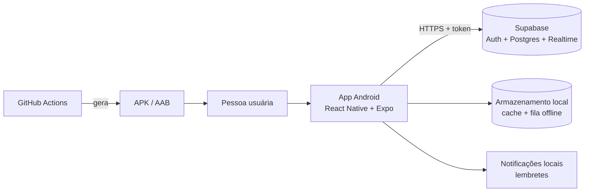
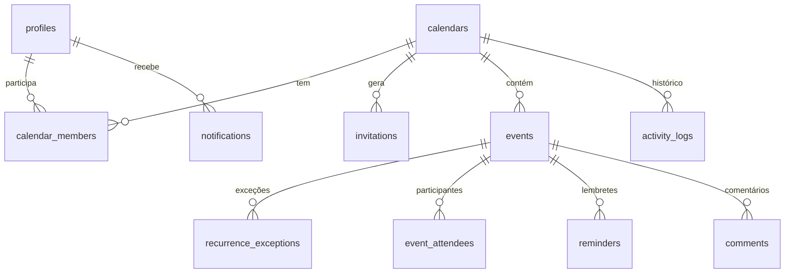

# Planejamento (Fase 0)

Este documento é a "primeira resposta" pedida na seção 41 do prompt mestre. Ele explica o que será construído, para quem, como, e em que ordem. As decisões técnicas detalhadas, com comparações e justificativas, estão em [DECISOES.md](DECISOES.md). A arquitetura completa, com diagramas, está em [ARQUITETURA.md](ARQUITETURA.md).

> Combinado com o proprietário do projeto: o planejamento foi aprovado na forma "planejar e já construir". Por isso, este documento foi escrito antes do código e as fases seguintes foram implementadas logo em seguida, com um commit por fase.

## 1. Compreensão do produto

Um aplicativo Android (com caminho aberto para iOS) de **agenda compartilhada**. Uma pessoa cria uma ou mais agendas, convida outras pessoas, define o que cada uma pode fazer e todos passam a ver os mesmos compromissos, sincronizados pela internet.

O ponto de partida é um casal, mas o produto não pode depender disso: o mesmo app precisa servir para família, amigos, república, equipe pequena, grupo de estudo, cuidadores, autônomos e grupos de viagem. Por isso o design é neutro e os "tipos de agenda" são só modelos de configuração, nunca limitações.

O núcleo do produto, em uma frase: **"todo mundo que precisa saber de um compromisso sabe dele, na hora certa, sem ver o que não deveria ver."**

## 2. Usuários (personas) e casos de uso

### Personas

| Persona | Quem é | O que precisa |
|---|---|---|
| **Casal** (persona principal) | Duas pessoas com rotinas diferentes | Ver a agenda um do outro, marcar compromissos juntos, lembrar de aniversários e viagens |
| **Família / cuidadores** | Mãe ou pai organizando consultas, escola, remédios dos avós | Vários membros, alguns só visualizam (ex.: avós), lembretes confiáveis |
| **Equipe pequena / autônomo** | Profissional com assistente ou sócio | Papéis diferentes (quem edita, quem só vê), eventos privados, histórico de alterações |
| **Grupo de viagem / república / amigos** | Pessoas que combinam algo temporário | Convite fácil por código ou link, sair do grupo depois, arquivar a agenda |

### Casos de uso principais (V1)

| Código | Caso de uso |
|---|---|
| UC01 | Criar conta, confirmar e-mail (quando ativado) e entrar |
| UC02 | Recuperar o acesso com código enviado por e-mail |
| UC03 | Criar uma agenda (nome, cor, tipo, fuso padrão) |
| UC04 | Convidar alguém por código (compartilhável por WhatsApp) ou por e-mail cadastrado |
| UC05 | Ver o convite (qual agenda, qual papel, quem convidou) e aceitar ou recusar |
| UC06 | Ver o calendário compartilhado (mês, semana, dia e lista) |
| UC07 | Criar, editar, duplicar, cancelar, concluir e excluir eventos |
| UC08 | Criar evento que se repete (diário, semanal, quinzenal, mensal, anual) e editar "só este", "este e os próximos" ou "todos" |
| UC09 | Definir lembretes pessoais (no horário, 5 min, ..., 1 dia antes, personalizado) |
| UC10 | Gerenciar membros: mudar papel, remover, transferir propriedade, sair |
| UC11 | Usar sem internet: ver o que já foi sincronizado e criar/editar/excluir eventos que serão enviados depois |
| UC12 | Resolver conflito quando duas pessoas alteram o mesmo evento |
| UC13 | Buscar e filtrar eventos respeitando permissões |
| UC14 | Ajustar preferências (tema, fuso, formato de data e hora, notificações) |
| UC15 | Exportar os próprios dados e excluir a conta |

## 3. Análise dos requisitos (seção 3 do prompt)

### Requisitos claros
Cadastro e login, várias agendas, papéis com permissões, convites com regras de status, eventos com validações, recorrência com exceções, lembretes, offline com fila, fusos horários, LGPD, segurança, documentação em português do Brasil, APK, GitHub com autoria do proprietário.

### Requisitos incompletos ou ambíguos (e a hipótese adotada)
| Ponto | Hipótese adotada |
|---|---|
| "Visibilidade" da agenda | Toda agenda é privada (só por convite). Link público fica para o futuro, como opt-in, revogável e com validade (regra 34). |
| Privacidade "personalizado conforme regra da agenda" | Fica para o futuro. V1 tem 4 níveis: todos os membros, só participantes, privado, e "ocupado" (título e horário visíveis, detalhes ocultos). |
| Convite "por e-mail" sem servidor de e-mail próprio | O convite fica registrado para aquele e-mail e aparece em "Convites recebidos" quando a pessoa entra com esse e-mail confirmado. O envio do e-mail em si fica para o futuro. |
| Exclusão de conta com "data programada" | V1 exclui na hora, após confirmação forte e explicação do impacto. O campo de agendamento existe no banco para uma futura carência. |
| Foto do perfil | V1 usa avatar com iniciais e cor (evita pedir permissão de galeria). Foto fica para o futuro. |
| Idioma | V1 só em português do Brasil, com a estrutura de tradução pronta. |
| Usuários menores de idade | Não tratados na V1. Os termos indicam uso por maiores de 18 anos ou com responsável (limitação documentada, regra 33). |

### Decisões técnicas necessárias
Stack mobile, backend, onde verificar permissões, como guardar datas, como fazer recorrência, como sincronizar offline, como gerar o APK sem computador potente. Todas respondidas em [DECISOES.md](DECISOES.md).

### Decisões de produto necessárias
Papéis padrão de novos membros, política de conflito de horário, prazo da lixeira, quem pode convidar. Todas viraram **configurações da agenda**, com valores padrão sensatos.

### Funcionalidades arriscadas
| Funcionalidade | Por que é arriscada | Como foi mitigada |
|---|---|---|
| Recorrência | Casos difíceis (dia 31, horário de verão, fusos) | Motor próprio e pequeno, coberto por testes dos casos do prompt |
| Offline e conflitos | Perda de dados, duplicação | Fila com identificador único por operação, versão por evento, mesclagem automática quando segura |
| Permissões | Vazamento de dados privados | Regras no banco (Row Level Security), testadas com usuários simulados |
| Notificações push remotas | Exigem Firebase e credenciais | V1 usa lembretes locais no aparelho e central de avisos dentro do app |
| E-mail | O serviço gratuito do Supabase só envia para membros da equipe | Documentado: desligar confirmação de e-mail ou configurar SMTP próprio |

### Fora da primeira versão
Integração com Google/Apple/Outlook, anexos, mapas, login social, 2FA, push remoto, links públicos, exportação ICS/CSV/PDF, iOS publicado, Play Store publicada. Tudo isso está planejado em [ROADMAP.md](ROADMAP.md), com dependências, riscos e prioridade.

## 4. Arquitetura recomendada (resumo)



O app conversa diretamente com o Supabase. **Toda permissão é verificada no banco** (Row Level Security e funções no servidor), então mesmo que alguém modifique o app, o banco recusa o que não for permitido. Detalhes em [ARQUITETURA.md](ARQUITETURA.md).

## 5. Stack escolhida

- **App:** React Native com Expo (SDK 58), TypeScript, Expo Router para navegação.
- **Por quê:** você já sabe JavaScript; TypeScript é JavaScript com tipos (o editor avisa erros antes de rodar). Expo gera Android e iOS do mesmo código e o APK pode ser gerado de graça no GitHub Actions.

## 6. Backend recomendado

- **Supabase** (plano gratuito): autenticação pronta, banco **PostgreSQL** (SQL muito parecido com o MySQL que você conhece), regras de acesso no próprio banco e sincronização em tempo real.
- **Como evitar dependência excessiva:** todo o banco está em arquivos SQL padrão versionados em `supabase/migrations/`. O app acessa o backend por uma única camada (`app-mobile/src/services/`). Migrar para uma API própria no futuro significa reescrever essa camada, não o app inteiro.

## 7. Modelo de dados (resumo)



Modelo completo, com campos, índices, regras e retenção em [MODELO_DE_DADOS.md](MODELO_DE_DADOS.md).

## 8. Fluxo de autenticação (resumo)

1. Cadastro com nome, e-mail e senha (a senha nunca é guardada pelo app; o Supabase guarda apenas o hash bcrypt).
2. Se a confirmação de e-mail estiver ligada, a pessoa digita o código recebido.
3. Login devolve um token de acesso (curta duração) e um token de renovação.
4. Os tokens ficam no **armazenamento seguro do Android** (Keystore, via `expo-secure-store`).
5. O app renova o token automaticamente. Sair apaga tokens e todo o cache local.
6. Recuperação de senha: código por e-mail, digitado no app, e nova senha.

## 9. Escopo da primeira versão

Prioridade 1 (seção 2 do prompt), todos implementados nesta entrega:
1. Cadastro e login
2. Criação de agenda (várias por pessoa)
3. Convite (código e e-mail cadastrado)
4. Aceitação do convite com prévia (agenda e papel antes de confirmar)
5. Calendário compartilhado (mês, semana, dia, lista)
6. Criar, editar e excluir eventos
7. Permissões (proprietário, administrador, editor, colaborador, visualizador)
8. Lembretes básicos (notificação local)
9. Sincronização online (com atualização em tempo real)
10. Tratamento de perda de conexão (cache, fila offline, conflitos)
11. Geração de APK (GitHub Actions)
12. Publicação organizada no GitHub
13. Documentação completa em português do Brasil

Incluídos também por serem baratos e úteis: recorrência com exceções, central de avisos no app, histórico de atividades, comentários simples, busca, filtros, exportação de dados e exclusão de conta.

## 10. Funcionalidades futuras

Ver [ROADMAP.md](ROADMAP.md). Ordem sugerida: push remoto, exportação ICS, anexos, Google Calendar, login com Google, iOS, Play Store, links públicos, 2FA.

## 11. Riscos técnicos

| Risco | Impacto | Mitigação |
|---|---|---|
| Expo/React Native mudam a cada versão | Build quebra ao atualizar | Versões travadas no `package-lock.json`; atualizar só com testes |
| Build Android no CI falhar | Sem APK | Workflow testado; alternativa documentada (EAS Build) |
| Bugs de fuso horário | Evento no dia errado | UTC + fuso IANA + datas locais para dia inteiro; testes de horário de verão |
| Sincronização duplicar dados | Eventos repetidos | ID gerado no aparelho + registro de operações processadas no servidor |
| Limites do plano gratuito | Projeto pausado após inatividade | Documentado; reativar no painel do Supabase |

## 12. Riscos de segurança

| Risco | Mitigação |
|---|---|
| Alguém altera o app para burlar permissões | Regras no banco (RLS) e funções no servidor; testes simulando usuários mal-intencionados |
| Vazamento de segredos no GitHub | `.gitignore`, `.env.example`, segredos só em GitHub Secrets; política em [SEGURANCA.md](SEGURANCA.md) |
| Código de convite adivinhado | Código aleatório de 60 bits, guardado só como hash, limite de tentativas |
| Usuário removido com dados no cache | App apaga o cache da agenda ao perder acesso; servidor já recusa na hora |
| Notificação mostrando dado sensível na tela bloqueada | Detalhes ocultos por padrão; a pessoa escolhe mostrar |
| APK assinado com chave pública de testes | Builds de teste usam chave de debug; produção usa chave própria em GitHub Secrets |

## 13. Decisões pendentes (dependem do proprietário)

1. Ligar ou não a confirmação de e-mail no Supabase (recomendado: ligar quando tiver SMTP próprio; até lá, desligar para conseguir convidar pessoas de fora da equipe do Supabase).
2. Liberar uma vaga de projeto ativo no Supabase (o plano gratuito permite 2) para reativar o projeto do app.
3. Criar uma chave de assinatura própria antes de distribuir o app para mais pessoas.

## 14. Plano por fases e complexidade

| Fase | Conteúdo | Complexidade | Status |
|---|---|---|---|
| 0 | Planejamento, decisões, arquitetura | Baixa | Concluída |
| 1 | Fundação: repositório, lint, formatação, tema, navegação, variáveis de ambiente | Média | Concluída |
| 2 | Autenticação: cadastro, login, logout, sessão, recuperação, rotas protegidas | Média | Concluída |
| 3 | Agendas e membros: criar, editar, convidar, aceitar, papéis, remover | Alta | Concluída |
| 4 | Eventos: CRUD, detalhes, filtros, calendário, validações, privacidade | Alta | Concluída |
| 5 | Recorrência e lembretes | Alta | Concluída |
| 6 | Sincronização: cache, offline, fila, retry, conflitos | Alta | Concluída |
| 7 | Segurança e qualidade: RLS, limites, auditoria, testes, erros | Média | Concluída |
| 8 | Build e distribuição: APK, AAB, CI/CD, instruções | Média | Configurada (o APK é gerado no GitHub Actions) |
| 9 | Publicação no GitHub | Baixa | Concluída nesta branch |

O status real e verificado de cada item está em [CHECKLIST.md](CHECKLIST.md).

## 15. Estrutura do repositório

```
app-teste-agenda/
├── app-mobile/              App Android/iOS (Expo + TypeScript)
│   ├── src/app/             Rotas (cada arquivo é uma tela navegável)
│   ├── src/screens/         Conteúdo das telas
│   ├── src/components/      Peças visuais reutilizáveis
│   ├── src/services/        Comunicação com o Supabase
│   ├── src/stores/          Estado global (sessão, dados, sincronização)
│   ├── src/hooks/           Funções React reutilizáveis
│   ├── src/models/          Tipos de dados (TypeScript)
│   ├── src/utils/           Datas, recorrência, filtros, erros
│   ├── src/validation/      Validações de formulários
│   ├── src/theme/           Cores, espaçamentos, tipografia
│   ├── src/i18n/            Textos do app
│   ├── src/offline/         Cache, fila e motor de sincronização
│   └── assets/              Ícones e imagens
├── supabase/                Backend
│   ├── migrations/          Scripts SQL que criam o banco
│   ├── seed.sql             Dados de demonstração (fictícios)
│   └── tests/               Testes do banco (permissões, convites, eventos)
├── docs/                    Telas, design, acessibilidade, testes
├── .github/workflows/       CI/CD (testes e geração do APK)
└── *.md                     Documentação
```

A responsabilidade de cada pasta está explicada em [ARQUITETURA.md](ARQUITETURA.md).

## 16. Perguntas realmente bloqueadoras

Foram feitas antes do início e já respondidas:
- Seguir direto para a construção: **sim**.
- Usar o Supabase da conta do proprietário: **sim** (reativar o projeto pausado).
- Autoria: **Gustavo Oliveira dos Santos**, e-mail de commits `gu.prgm@gmail.com`, licença **MIT**.

Pendência que não bloqueia o código, mas bloqueia o uso real: liberar uma vaga de projeto ativo no Supabase (veja [GUIA_DE_DEPLOY.md](GUIA_DE_DEPLOY.md)).
