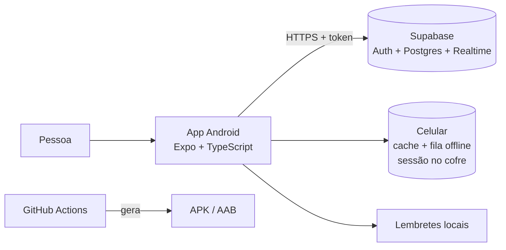

# Agenda Compartilhada

Aplicativo Android de **agenda compartilhada**: você cria agendas, convida pessoas e todo mundo vê os mesmos compromissos, sincronizados pela internet, cada pessoa com o nível de acesso que você escolher. Funciona para casal, família, amigos, república, equipe pequena, grupo de estudo, cuidadores e viagens.

> **Comece aqui (para quem não programa)**
>
> 1. **Quero instalar no celular:** siga o [COMO_INSTALAR.md](COMO_INSTALAR.md).
> 2. **Quero colocar o app no ar pela primeira vez** (servidor, APK, chave de assinatura): siga o [GUIA_DE_DEPLOY.md](GUIA_DE_DEPLOY.md). São cliques no painel do Supabase e do GitHub, sem programar.
> 3. **Algo deu errado:** veja o [TROUBLESHOOTING.md](TROUBLESHOOTING.md).
> 4. **O que está pronto e o que falta:** veja o [CHECKLIST.md](CHECKLIST.md).

## Que problema resolve

Quem divide a vida com outras pessoas costuma combinar compromissos por mensagem e perde informação: "era terça ou quarta?", "quem leva a vó no médico?", "você sabia da reunião da escola?". O app junta tudo em um calendário único, com:

- cada pessoa vendo só o que deve ver (eventos podem ser privados ou só para participantes);
- lembretes no celular de cada um;
- funcionamento sem internet (as mudanças são enviadas quando a conexão volta);
- histórico de quem mudou o quê.

## Funcionalidades

| Área | O que já funciona nesta versão |
|---|---|
| Conta | Cadastro, login, confirmação de e-mail por código (opcional), recuperação de senha por código, troca de senha, perfil com avatar de iniciais, lista de aparelhos conectados, sair, exportar dados, excluir conta |
| Agendas | Várias agendas por pessoa, cor, tipo (pessoal, compartilhada, família, profissional, projeto, viagem, personalizada), fuso horário, arquivar, duplicar, lixeira por 30 dias |
| Compartilhamento | Convite por **código** (enviado por WhatsApp ou qualquer app) ou para um **e-mail** cadastrado; prévia da agenda e do papel antes de aceitar; validade; cancelamento; limite de tentativas |
| Papéis | Proprietário, administrador, editor, colaborador e visualizador; transferência de propriedade; remoção com perda de acesso imediata |
| Eventos | Criar, editar, duplicar, cancelar, concluir, excluir e restaurar; dia inteiro; local; link; observações; participantes; 4 níveis de privacidade; comentários |
| Recorrência | Diária, semanal (dias da semana), quinzenal, mensal, anual, com fim por data ou quantidade; editar ou excluir "só este", "este e os próximos" ou "todos" |
| Calendário | Visões de mês, semana, dia e lista; filtros por agenda, tipo, status, participante, cor, privacidade, recorrência e período; busca |
| Lembretes | Notificações locais no celular (no horário, 5 min, 15 min, 30 min, 1 h, 1 dia antes ou personalizado); horário de silêncio; tela bloqueada sem detalhes por padrão |
| Offline | Cache local, fila de alterações com novas tentativas automáticas, tela de sincronização, resolução de conflitos quando duas pessoas mudam o mesmo evento |
| Tempo real | Alterações de outras pessoas aparecem sozinhas (Supabase Realtime) |
| Avisos | Central de avisos no app (convites, alterações em eventos, remoções) |
| Privacidade | LGPD: exportação de dados, exclusão de conta com explicação do impacto, política de privacidade no app |

O mapa completo de telas está em [docs/TELAS.md](docs/TELAS.md).

## Capturas de tela

Ainda **não há capturas das telas internas**, porque o servidor (Supabase) do projeto está pausado e as telas internas dependem dele (veja [Limitações conhecidas](#limitações-conhecidas)). As capturas disponíveis, quando existirem, ficam em [`docs/capturas/`](docs/capturas/).

## Tecnologias

| Parte | Tecnologia | Por quê (resumo) |
|---|---|---|
| App | React Native + **Expo SDK 58**, **TypeScript**, Expo Router | Um código só para Android e iOS; APK gerado de graça no GitHub |
| Estado e dados no celular | Zustand, AsyncStorage, `expo-secure-store` | Simples; sessão guardada no cofre do Android |
| Datas | Luxon | Fusos horários e horário de verão corretos |
| Servidor | **Supabase** (PostgreSQL 17, Auth, Realtime) | Login pronto, banco SQL, regras de acesso no próprio banco, plano gratuito |
| Testes | Jest (app), PGlite + `node:test` (banco) | Rodam no computador e no GitHub, sem Docker |
| CI/CD | GitHub Actions | Testa tudo a cada envio e gera APK/AAB |

Comparações e justificativas completas em [DECISOES.md](DECISOES.md).

## Arquitetura resumida



Toda permissão é conferida **no banco** (Row Level Security e funções no servidor). Mesmo um app modificado não consegue ver ou mudar o que não pode. Detalhes em [ARQUITETURA.md](ARQUITETURA.md), [MODELO_DE_DADOS.md](MODELO_DE_DADOS.md), [REGRAS_DE_NEGOCIO.md](REGRAS_DE_NEGOCIO.md) e [SEGURANCA.md](SEGURANCA.md).

## Estrutura do repositório

```
app-mobile/          App (Expo). Código em app-mobile/src
supabase/            Banco: migrations (SQL), dados de demonstração e testes
docs/                Telas, design, acessibilidade, testes
scripts/             Verificação de segredos
.github/workflows/   Qualidade (testes) e Gerar APK Android
*.md                 Documentação
```

## Requisitos

**Para usar o app:** celular Android 7.0 ou mais novo, com processador ARM (praticamente todos), cerca de 150 MB livres e internet no primeiro acesso.

**Para colocar no ar (sem programar):** conta gratuita no [Supabase](https://supabase.com) e a conta do GitHub onde está este repositório. Passo a passo no [GUIA_DE_DEPLOY.md](GUIA_DE_DEPLOY.md).

**Para desenvolver:** Node.js 22 ou mais novo, Git e, opcionalmente, Android Studio. Passo a passo no [GUIA_DE_DESENVOLVIMENTO.md](GUIA_DE_DESENVOLVIMENTO.md).

## Instalação, configuração e execução (resumo)

| Quero... | Onde está explicado |
|---|---|
| Instalar o APK no celular | [COMO_INSTALAR.md](COMO_INSTALAR.md) |
| Criar o banco no Supabase e aplicar as migrations | [GUIA_DE_DEPLOY.md, parte 1](GUIA_DE_DEPLOY.md#parte-1-servidor-supabase) |
| Configurar o endereço do servidor no GitHub | [GUIA_DE_DEPLOY.md, parte 2](GUIA_DE_DEPLOY.md#parte-2-ligar-o-github-ao-servidor) |
| Rodar o app no computador ou no celular durante o desenvolvimento | [GUIA_DE_DESENVOLVIMENTO.md](GUIA_DE_DESENVOLVIMENTO.md) |

Execução rápida para quem já tem o ambiente pronto:

```bash
# Pasta: app-mobile
cp .env.example .env      # depois edite o .env com a URL e a chave pública do Supabase
npm ci                    # instala as dependências
npx expo start            # abre o servidor de desenvolvimento (leia o QR code com o app Expo Go ou use "a" para Android)
```

## Testes

```bash
# Pasta: supabase   (testa tabelas, permissões, convites, eventos, exclusão de conta)
npm ci && npm test

# Pasta: app-mobile (testa datas, recorrência, permissões, filtros, validações, fila offline)
npm ci && npm run check   # tipos + lint + formatação + testes
```

Os mesmos testes rodam sozinhos no GitHub a cada envio (workflow **Qualidade**). Estratégia, números e roteiro de teste manual em [docs/TESTES.md](docs/TESTES.md).

## Build, APK e AAB

- O **APK** (arquivo que se instala direto no celular) e o **AAB** (formato que a Google Play Store pede) são gerados pelo GitHub Actions, no workflow **Gerar APK Android**.
- Para gerar e publicar um APK com link de download: GitHub > **Actions** > **Gerar APK Android** > **Run workflow**. Em cerca de 20 minutos o arquivo aparece em **Releases**.
- Sem uma chave de assinatura própria, o APK sai assinado com uma **chave de testes** (marcado como "pré-lançamento"). Serve para testar entre pessoas conhecidas. Para distribuir de verdade, configure sua chave: [GUIA_DE_DEPLOY.md, parte 3](GUIA_DE_DEPLOY.md#parte-3-chave-de-assinatura-própria).

Android mínimo: 7.0. Permissões pedidas (e o porquê de cada uma): [DECISOES.md, D22](DECISOES.md#d22-lista-fechada-de-permissões-do-android).

## Publicação

- **Distribuição direta (APK):** página [Releases](https://github.com/GustavoOliveira-xxx/app-teste-agenda/releases) do repositório.
- **Google Play Store (AAB):** requer conta de desenvolvedor e uma série de cadastros; o caminho está no [GUIA_DE_DEPLOY.md, parte 5](GUIA_DE_DEPLOY.md#parte-5-google-play-store).
- **iPhone (iOS):** o código é compatível, mas a publicação exige conta Apple Developer paga; explicado no [GUIA_DE_DEPLOY.md, parte 6](GUIA_DE_DEPLOY.md#parte-6-iphone-ios).

## Problemas comuns

Veja [TROUBLESHOOTING.md](TROUBLESHOOTING.md) (app, instalação, servidor, GitHub Actions e desenvolvimento) e a seção de problemas do [COMO_INSTALAR.md](COMO_INSTALAR.md#problemas-comuns).

## Roadmap

Integrações futuras (Google Calendar, exportação ICS, push remoto, anexos, login com Google, 2FA e outras), com dependências, riscos, permissões, impacto em privacidade, banco e custos: [ROADMAP.md](ROADMAP.md). Histórico de versões: [CHANGELOG.md](CHANGELOG.md).

## Limitações conhecidas

- **Servidor pausado:** o projeto Supabase da conta está pausado e não pôde ser reativado automaticamente porque a conta já tem 2 projetos gratuitos ativos (limite do plano). Enquanto isso, o app instalado abre na tela "Servidor não configurado" ou não conecta. Como resolver: [GUIA_DE_DEPLOY.md, parte 1](GUIA_DE_DEPLOY.md#parte-1-servidor-supabase).
- **Não testado em celular físico** nem com o servidor real: a lógica foi testada automaticamente (banco e app) e o APK compila no GitHub, mas o uso de ponta a ponta ainda precisa do roteiro manual de [docs/TESTES.md](docs/TESTES.md).
- **Sem testes automáticos de interface** (cliques simulados); as telas são verificadas pelo roteiro manual.
- **E-mail:** sem um servidor de e-mail próprio (SMTP), o Supabase só envia e-mails para membros da equipe do projeto. Por isso o guia recomenda desligar a confirmação de e-mail no começo.
- **Convite por e-mail não envia e-mail:** o convite fica registrado e aparece para a pessoa quando ela entra com aquele e-mail. O jeito principal de convidar é o código.
- **Lembretes são locais:** cada celular agenda os próprios lembretes; não há push remoto do servidor nesta versão.
- **APK de testes:** sem configurar sua chave, o APK usa a chave pública de testes do Android.
- **Somente português do Brasil** nesta versão (a estrutura de tradução está pronta).
- **iOS** não foi compilado nem testado.

Lista completa, com status de cada requisito: [CHECKLIST.md](CHECKLIST.md).

## Licença

[MIT](LICENSE). Você pode usar, copiar e modificar, mantendo o aviso de copyright.

## Créditos

- Autor e proprietário: **Gustavo Oliveira dos Santos**.
- Desenvolvido com o apoio do Claude Code (assistente de programação da Anthropic), que aparece como coautor técnico nos commits.
- Bibliotecas de código aberto listadas em `app-mobile/package.json` e `supabase/package.json`, cada uma com sua licença.
