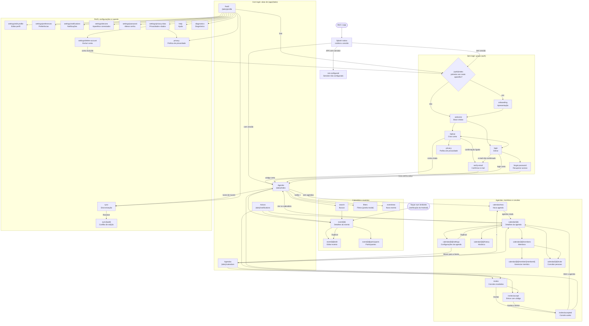

# Telas

Este documento mostra todas as telas do Agenda Compartilhada, como se vai de uma para outra, os fluxos principais e o que cada tela faz.

Tudo aqui foi conferido **lendo o código** em `app-mobile/src` e pelos testes de tela da versão web (capturas em [capturas/](capturas/)). O app ainda não foi usado de ponta a ponta num celular com o servidor real (veja o [README](../README.md)). Quando algo existe só em parte, isso está dito na tabela.

**Em telas grandes** (tablet e computador) as mesmas telas mudam de arrumação: as quatro abas viram um menu lateral, o conteúdo fica numa coluna centralizada e, no computador, a visão Mês mostra o calendário e os eventos do dia lado a lado. Detalhes em [DESIGN.md, Tamanhos de tela](DESIGN.md#tamanhos-de-tela).

Documentos relacionados: [ARQUITETURA.md](../ARQUITETURA.md) (como as peças se encaixam), [REGRAS_DE_NEGOCIO.md](../REGRAS_DE_NEGOCIO.md) (papéis e permissões) e [DESIGN.md](DESIGN.md) (cores, componentes e textos).

## Como ler as rotas

- Cada arquivo dentro de `app-mobile/src/app/` é um endereço (rota). Exemplo: `src/app/(app)/event/[id]/edit.tsx` vira `/event/123/edit`.
- Pastas entre parênteses, como `(auth)`, `(app)` e `(tabs)`, só organizam: não aparecem no endereço.
- `[id]`, `[memberId]` e `[opId]` são partes variáveis (o identificador da agenda, do membro ou da operação).
- Quase todo arquivo de rota tem uma linha só, que reaproveita uma tela de `src/screens/`. Por isso a tabela mostra as duas coisas: a rota e o componente.
- **Proteção de rotas** (`src/app/_layout.tsx`, com `Stack.Protected`):
  - sem o endereço do servidor no APK, só existe a tela `not-configured`;
  - sem login, só existem as telas de `(auth)`;
  - com login, só existem as telas de `(app)`. Ao sair da conta, o app volta sozinho para `(auth)`.

## Mapa de navegação

Observações sobre o mapa:

- As quatro abas ficam sempre visíveis na parte de baixo. A aba **Avisos** mostra a quantidade de avisos não lidos (até "99+").
- **Filtros** abre como janela modal (por cima da Agenda). As demais telas abrem empilhadas, com botão de voltar.
- Tocar num lembrete do Android abre direto os detalhes do evento (`src/app/(app)/_layout.tsx`).
- Depois de sair da conta, a apresentação não aparece de novo: o app lembra neste aparelho que ela já foi vista e vai direto para Boas-vindas.

## Fluxos principais

### 1. Primeiro acesso

1. A pessoa abre o app. A splash nativa (ícone sobre fundo claro ou escuro) fica na tela enquanto o app confere se já existe sessão guardada.
2. Sem sessão e na primeira vez neste aparelho, abre a **Apresentação**: 3 passos ("Uma agenda para várias pessoas", "Cada pessoa com seu papel", "Funciona até sem internet"), com os botões **Pular**, **Próximo** e **Começar**.
3. Em **Boas-vindas**, toca em **Criar conta**.
4. Em **Criar conta**, preenche nome, e-mail, senha e confirmação. Pode tocar em "Ler a Política de Privacidade" antes. Toca em **Criar conta**.
5. Se a confirmação de e-mail estiver ligada no servidor, abre **Confirme seu e-mail**: a pessoa digita o código de 6 dígitos (pode pedir "Reenviar código").
6. Com a sessão criada, o app troca sozinho para a área logada e abre a aba **Agenda**. O banco já cria uma agenda pessoal chamada "Minha agenda" para a conta nova.

### 2. Criar uma agenda e convidar alguém

1. Na aba **Agendas**, toca no **+** do topo (ou em "Nova agenda", se a lista estiver vazia).
2. Preenche nome, descrição (opcional), cor, tipo e fuso padrão. Toca em **Criar agenda** (precisa de internet).
3. Aparece "Agenda criada!" e abre **Detalhes da agenda**.
4. Toca em **Convidar pessoas** (só aparece para quem pode convidar).
5. Escolhe o papel de quem vai entrar (só papéis abaixo do seu; o proprietário pode conceder qualquer um, menos proprietário), um e-mail opcional, a validade (1, 7 ou 30 dias, ou sem validade; padrão 7 dias) e quantas pessoas podem usar (1, até 5 ou sem limite; padrão 1). Convite por e-mail vale para 1 pessoa.
6. Toca em **Gerar convite**. O código aparece em destaque **uma única vez**, com os botões **Copiar** e **Compartilhar** (a mensagem já explica onde digitar o código).
7. Mais abaixo, a lista "Convites desta agenda" mostra cada convite com status, usos e validade. Convites pendentes podem ser cancelados (com confirmação).

### 3. Aceitar um convite por código

1. Na aba **Agendas**, toca em **Entrar com código de convite** (ou, em "Convites recebidos", em **Tenho um código de convite**).
2. Digita o código. O app formata sozinho no padrão `XXXX-XXXX-XXXX` (12 letras ou números).
3. Toca em **Ver convite**. Antes de aceitar, a tela mostra: nome e cor da agenda, o papel que a pessoa terá (com a explicação do papel), quem convidou e até quando vale. Se a pessoa já participa, avisa. Se o convite não estiver mais pendente (expirado, cancelado, esgotado), mostra o status no lugar do botão de aceitar.
4. Toca em **Aceitar e entrar** (ou **Agora não**).
5. Abre **Convite aceito** ("Tudo certo!"), com os botões **Abrir a agenda** e **Agenda**.

Convites enviados para o e-mail da pessoa também aparecem em **Convites recebidos**, com **Aceitar e entrar** e **Recusar**.

### 4. Criar um evento que se repete e editá-lo

1. Na aba **Agenda**, escolhe um dia e toca no botão redondo **+** (ele só aparece se existir alguma agenda em que a pessoa pode criar eventos).
2. Escolhe a agenda, o título, as datas e horas (ou "Dia inteiro").
3. Em **Repetir**, escolhe uma opção pronta (Todos os dias, Toda semana, A cada 2 semanas, Todo mês, Todo ano) ou **Personalizar...**: frequência, intervalo (1 a 99), dias da semana e término (nunca, numa data ou após N vezes). Abaixo aparece um resumo em português da regra.
4. Escolhe lembretes (até 5) e toca em **Salvar**. Aparece "Evento criado." (ou, sem internet, "Salvo neste aparelho. Será enviado quando houver internet.").
5. Para editar, abre uma ocorrência e toca em **Editar**. Como o evento se repete, aparece a pergunta "O que você quer alterar?" com três escolhas:
   - **Somente esta ocorrência**: o formulário esconde o que vale para a série inteira (dia inteiro, repetição, endereço, link, tipo, status, privacidade, cor, responsável, participantes e fuso). O app grava uma exceção só para aquela data.
   - **Esta e as próximas**: a série antiga passa a terminar antes desta data e nasce uma série nova com as mudanças. Se a ocorrência escolhida for a primeira, isso equivale a "todas".
   - **Todas as ocorrências da série**: altera a série inteira.
6. Excluir segue a mesma pergunta ("O que você quer excluir?"): só esta cancela aquela data; esta e as próximas encurta a série; todas exclui o evento. Ao excluir um evento inteiro que já estava no servidor, o aviso "Evento excluído." traz o botão **Desfazer** por 7 segundos.

### 5. Editar sem internet e resolver um conflito

1. Sem internet, aparece no topo a faixa "Sem internet. Você está vendo os dados guardados neste aparelho." (com a quantidade de alterações aguardando envio). O ícone de nuvem no topo da Agenda muda de cor.
2. A pessoa cria, edita, cancela, conclui ou exclui eventos normalmente. Cada alteração entra numa fila no aparelho, e o evento mostra a etiqueta "Aguardando envio".
3. Ações que dependem do servidor (convites, membros, configurações, conta) avisam: "Esta ação precisa de internet. Conecte-se e tente de novo."
4. Quando a internet volta, o app envia a fila sozinho.
5. Se outra pessoa alterou o mesmo evento, mas em **campos diferentes**, o app junta as duas mudanças sem perguntar.
6. Se as duas mexeram **no mesmo campo**, a alteração fica com o status "Conflito". Em **Perfil > Sincronização** (ou tocando no ícone de nuvem), a pessoa toca em **Resolver**.
7. A tela **Conflito de edição** mostra, campo por campo, "Sua versão" e "Versão atual (servidor)". A pessoa escolhe **Manter a minha versão** ou **Manter a versão atual**.
8. Se o evento foi excluído por outra pessoa, as opções são **Recriar o evento com as minhas alterações** ou **Aceitar a exclusão**.
9. Alterações que falharam podem ser reenviadas (**Tentar de novo**) ou descartadas (**Descartar**, com confirmação).

### 6. Exportar meus dados e excluir a conta

1. Em **Perfil > Privacidade e dados**, toca em **Gerar e compartilhar arquivo** (precisa de internet; o servidor limita a 5 exportações por hora).
2. O app recebe todos os dados da pessoa em JSON e abre o menu de compartilhamento do Android com esse conteúdo.
3. Para excluir a conta, toca em **Excluir minha conta**. A tela mostra o impacto antes de qualquer coisa: quantas agendas serão apagadas, quantos eventos criados em agendas de outras pessoas continuarão lá (sem o nome dela) e quantos comentários serão apagados.
4. Se a pessoa for proprietária de agendas que têm outros membros, a tela lista essas agendas e bloqueia a exclusão até a propriedade ser transferida.
5. A pessoa digita **EXCLUIR**; só então o botão **Excluir minha conta para sempre** fica ativo.
6. Depois da exclusão aparece "Sua conta foi excluída.", os dados do aparelho são apagados e o app volta para Boas-vindas.

## As 36 telas previstas

Legenda da coluna "Quem acessa": os papéis são Proprietário, Administrador, Editor, Colaborador e Visualizador (detalhes em [REGRAS_DE_NEGOCIO.md](../REGRAS_DE_NEGOCIO.md#papéis-e-permissões-resumo)). Rotas abaixo são relativas a `app-mobile/src/app/` e componentes a `app-mobile/src/`.

| # | Tela pedida | Rota | Componente | Para que serve | Quem acessa | Status |
|---|---|---|---|---|---|---|
| 1 | Splash ou carregamento inicial | Configurada em `app-mobile/app.json` (plugin `expo-splash-screen`) e controlada em `_layout.tsx` | Sem componente próprio | Mostra o ícone sobre `#F7F8FA` (claro) ou `#111318` (escuro) até o app saber se há sessão; depois a Agenda mostra "Carregando..." até ler o cache do aparelho | Todos | Implementada (splash nativa do sistema, não uma tela em React) |
| 2 | Boas-vindas | `(auth)/welcome.tsx` | `screens/auth/WelcomeScreen.tsx` | Logo, nome do app, a frase "Organize compromissos com quem importa..." e os botões "Criar conta" e "Já tenho conta" | Sem login | Implementada |
| 3 | Onboarding | `(auth)/onboarding.tsx` (aberta por `(auth)/index.tsx`) | `screens/auth/OnboardingScreen.tsx` | Apresentação em 3 passos, com Pular, Próximo e Começar | Sem login, só na primeira abertura no aparelho | Implementada |
| 4 | Cadastro | `(auth)/signup.tsx` | `screens/auth/SignupScreen.tsx` | Nome, e-mail, senha e confirmação, com aviso e link para a Política de Privacidade | Sem login | Implementada |
| 5 | Login | `(auth)/login.tsx` | `screens/auth/LoginScreen.tsx` | E-mail e senha (com mostrar e esconder), espera crescente após 5 erros, links para recuperar senha e criar conta | Sem login | Implementada |
| 6 | Recuperação de senha | `(auth)/forgot-password.tsx` | `screens/auth/ForgotPasswordScreen.tsx` | Dois passos na mesma tela: e-mail; depois código de 6 dígitos e nova senha. Ao salvar, a pessoa já entra | Sem login | Implementada |
| 7 | Confirmação de e-mail | `(auth)/verify-email.tsx` | `screens/auth/VerifyEmailScreen.tsx` | Digitar o código de 6 dígitos recebido por e-mail, reenviar o código | Sem login, quando a confirmação está ligada no servidor | Implementada |
| 8 | Lista de agendas | `(app)/(tabs)/calendars.tsx` | `screens/calendars/CalendarsScreen.tsx` | Agendas ativas, arquivadas e na lixeira, com cor, tipo, número de membros e "Seu papel"; atalhos "Entrar com código de convite" e "Convites recebidos (n)" | Qualquer pessoa logada (vê só as agendas de que participa) | Implementada |
| 9 | Criação de agenda | `(app)/calendar/new.tsx` | `screens/calendars/NewCalendarScreen.tsx` e `CalendarFormFields.tsx` | Nome, descrição, cor, tipo e fuso horário padrão | Qualquer pessoa logada, com internet | Implementada |
| 10 | Detalhes da agenda | `(app)/calendar/[id]/index.tsx` | `screens/calendars/CalendarDetailScreen.tsx` | Resumo (cor, tipo, papel, membros, explicação do papel); atalhos para ver no calendário, membros, convidar, histórico e configurações; ligar ou desligar avisos desta agenda; sair da agenda; restaurar ou excluir de vez quando está na lixeira | Membros. "Convidar" só para quem pode convidar; "Configurações" só para Proprietário e Administrador; restaurar e excluir de vez só para o Proprietário | Implementada |
| 11 | Calendário mensal | `(app)/(tabs)/index.tsx` | `screens/calendar/CalendarScreen.tsx` (modo "Mês") e `components/MonthGrid.tsx` | Grade do mês com até 3 pontinhos coloridos por dia (e "+" se houver mais) e a lista do dia escolhido logo abaixo | Qualquer pessoa logada | Implementada |
| 12 | Calendário semanal | `(app)/(tabs)/index.tsx` | `CalendarScreen.tsx` (modo "Semana") | Os 7 dias da semana, cada um com sua lista de eventos, e setas para semana anterior e seguinte | Qualquer pessoa logada | Parcial: os dias aparecem como listas; não há grade de horários |
| 13 | Calendário diário | `(app)/(tabs)/index.tsx` | `CalendarScreen.tsx` (modo "Dia") | Eventos de um dia, com setas para o dia anterior e o seguinte | Qualquer pessoa logada | Parcial: é uma lista do dia; não há linha do tempo por hora |
| 14 | Lista de eventos | `(app)/(tabs)/index.tsx` | `CalendarScreen.tsx` (modo "Lista") | Eventos agrupados por dia, com as abas "Próximos" e "Passados" (180 dias para cada lado) | Qualquer pessoa logada | Implementada (é um modo da tela Agenda) |
| 15 | Criação de evento | `(app)/event/new.tsx` | `screens/events/EventFormScreen.tsx` e `ReminderPicker.tsx` | Agenda, título, dia inteiro, datas e horas, repetição, local e lembretes. Em "Mais opções": descrição, endereço, link, tipo, status, quem pode ver, cor, responsável, participantes e fuso | Colaborador ou acima, em agenda ativa | Implementada |
| 16 | Edição de evento | `(app)/event/[id]/edit.tsx` | `EventFormScreen.tsx` (o mesmo formulário) | Mesmo formulário, preenchido; em evento repetido recebe o escopo escolhido (só esta, esta e as próximas, todas) | Proprietário e Administrador; Editor (os próprios, ou todos se a agenda permitir); Colaborador (só os próprios) | Implementada |
| 17 | Detalhes do evento | `(app)/event/[id]/index.tsx` | `screens/events/EventDetailScreen.tsx` | Título, agenda, horário (e o horário no fuso do evento, se for outro), repetição, status, tipo, privacidade, local, link, descrição, responsável, participantes, quem criou; "Meus lembretes"; ações editar, concluir, cancelar, duplicar, compartilhar e excluir; comentários; histórico do evento | Membros que podem ver o evento. Evento "Ocupado" aparece só como "Ocupado". Ações só para quem pode editar; comentar só Colaborador ou acima | Implementada |
| 18 | Participantes do evento | `(app)/event/[id]/participants.tsx` | `screens/events/ParticipantsScreen.tsx` | Membros da agenda com chave liga e desliga (para quem pode editar) ou só a lista de participantes (para quem só vê) | Quem vê o evento; alterar só quem pode editar | Implementada |
| 19 | Convites recebidos | `(app)/invites/index.tsx` | `screens/invites/ReceivedInvitesScreen.tsx` | Convites enviados para o e-mail da pessoa, com Aceitar e Recusar, e o atalho "Tenho um código de convite" | Qualquer pessoa logada, com internet (convites por e-mail exigem e-mail confirmado) | Implementada |
| 20 | Convite aceito | `(app)/invites/accepted.tsx` | `screens/invites/InviteAcceptedScreen.tsx` | "Tudo certo!" com o nome da agenda e o papel; botões "Abrir a agenda" e "Agenda" | Quem acabou de aceitar um convite | Implementada |
| 21 | Membros da agenda | `(app)/calendar/[id]/members.tsx` | `screens/members/MembersScreen.tsx` | Lista com avatar, nome, papel e explicação do papel; botão "Convidar pessoas" quando permitido | Membros | Implementada |
| 22 | Configurações de membros | `(app)/calendar/[id]/member/[memberId].tsx` | `screens/members/MemberScreen.tsx` | Alterar papel, remover da agenda e tornar proprietário; mostra data de entrada e última atividade. Papel padrão e quem pode convidar ficam na seção "Convites" das Configurações da agenda (tela 23) | Proprietário (todos menos ele mesmo); Administrador (só papéis abaixo de administrador); "Tornar proprietário" só o Proprietário | Implementada (dividida entre esta tela e a tela 23) |
| 23 | Configurações da agenda | `(app)/calendar/[id]/settings.tsx` | `screens/calendars/CalendarSettingsScreen.tsx` | Dados da agenda; conflitos de horário; avisar membros; (só Proprietário) editores editam todos, permitir eventos privados, papel padrão e quem convida; duplicar; exportar eventos (JSON); arquivar, desarquivar e mover para a lixeira | Proprietário e Administrador; itens exclusivos só para o Proprietário | Implementada |
| 24 | Perfil | `(app)/(tabs)/profile.tsx` | `screens/settings/ProfileScreen.tsx` | Avatar, nome, e-mail (confirmado ou não) e o menu de configurações, sincronização, ajuda, política, diagnóstico e sair; versão do app | Qualquer pessoa logada | Implementada |
| 25 | Configurações pessoais | `(app)/settings/preferences.tsx`, `edit-profile.tsx`, `password.tsx`, `devices.tsx` | `screens/settings/PreferencesScreen.tsx`, `EditProfileScreen.tsx`, `ChangePasswordScreen.tsx`, `DevicesScreen.tsx` | Tema (automático, claro, escuro), idioma, fuso (do celular ou escolhido), formato de data e hora, início da semana; nome e cor do avatar; trocar senha; aparelhos conectados e "Sair de todos os outros aparelhos" | Qualquer pessoa logada (salvar precisa de internet) | Implementada (o idioma tem só "Português (Brasil)") |
| 26 | Configurações de notificações | `(app)/settings/notifications.tsx` | `screens/settings/NotificationSettingsScreen.tsx` | Permissão do Android; liga e desliga geral e por tipo; lembrete padrão; detalhes na tela bloqueada; som; vibração; horário de silêncio | Qualquer pessoa logada | Implementada (a própria tela avisa que avisos de alterações aparecem só dentro do app; não há push remoto) |
| 27 | Busca | `(app)/search.tsx` | `screens/misc/SearchScreen.tsx` | Busca por título, local, descrição e agenda; a partir de 2 letras, espera 350 ms após a última tecla; no servidor com internet, nos eventos do aparelho sem internet; respeita os filtros ativos | Qualquer pessoa logada | Implementada |
| 28 | Resultados da busca | `(app)/search.tsx` | `SearchScreen.tsx` | Contagem "{n} resultado(s)", lista de eventos e "Nenhum evento encontrado para ..." | Qualquer pessoa logada | Implementada (na mesma tela da Busca, não é tela separada) |
| 29 | Histórico | `(app)/calendar/[id]/history.tsx`; no evento, seção dentro de `event/[id]` | `screens/calendars/HistoryScreen.tsx` (`ActivityList`) e `EventHistory` em `EventDetailScreen.tsx` | Quem fez o quê e quando; 50 itens por vez com "Carregar mais" (no evento, os 20 últimos) | Membros. Itens administrativos só para Proprietário, Administrador ou quem fez a ação (filtro no banco) | Implementada |
| 30 | Sincronização | `(app)/sync/index.tsx` e `(app)/sync/[opId].tsx` | `screens/sync/SyncScreen.tsx` e `ConflictScreen.tsx` | Situação da conexão, última sincronização, "Sincronizar agora", fila de alterações com status, tentar de novo, descartar, resolver conflito e métricas | Qualquer pessoa logada | Implementada |
| 31 | Estado offline | Aparece dentro das telas | `components/OfflineBanner.tsx` (e o ícone de nuvem no topo da Agenda) | Faixa "Sem internet. Você está vendo os dados guardados neste aparelho." com o número de alterações pendentes | Todos | Implementada como faixa e mensagens, não como tela separada |
| 32 | Estado de erro | Aparece dentro das telas; `not-configured.tsx` | `components/StateViews.tsx` (`ErrorState`), `components/AppErrorBoundary.tsx` | Mensagem amigável com "Tentar de novo"; tela de erro inesperado sem detalhes técnicos; tela "Servidor não configurado" | Todos | Implementada como componentes reutilizados |
| 33 | Ajuda | `(app)/help.tsx` | `screens/misc/HelpScreen.tsx` e `content/help.ts` | 9 perguntas frequentes que abrem e fecham ao toque | Qualquer pessoa logada | Implementada (não há link para a Ajuda nas telas sem login) |
| 34 | Política de privacidade | `(auth)/privacy.tsx` e `(app)/privacy.tsx` | `screens/misc/PrivacyScreen.tsx` e `content/privacyPolicy.ts` | Texto da política, versão "1.0 (outubro de 2026)" | Todos, com ou sem login | Implementada |
| 35 | Exclusão de conta | `(app)/settings/delete-account.tsx` | `screens/settings/DeleteAccountScreen.tsx` | Mostra o impacto, bloqueia se houver agendas com outras pessoas e pede para digitar EXCLUIR | Qualquer pessoa logada, com internet | Implementada |
| 36 | Confirmação de ações destrutivas | Aparece por cima de qualquer tela | `components/Feedback.tsx` (função `confirm`) | Diálogo com título, explicação do impacto, botão vermelho e "Cancelar"; pode exigir digitar uma palavra (EXCLUIR) ou oferecer escolhas (escopo de repetição) | Todos | Implementada como diálogo, não como tela separada |

**Resumo:** 34 telas implementadas (várias delas como parte de outra tela ou como componente reutilizado, como dito na tabela) e 2 parciais (calendário semanal e diário, que não têm grade de horários). Nenhuma das 36 está ausente.

### Telas extras (além das 36 previstas)

| Rota | Componente | Para que serve | Quem acessa |
|---|---|---|---|
| `not-configured.tsx` | Na própria rota | Explica que o APK foi gerado sem `EXPO_PUBLIC_SUPABASE_URL` e `EXPO_PUBLIC_SUPABASE_ANON_KEY` e que é preciso gerar o app de novo | Só aparece nesse caso; não há como sair dela |
| `(auth)/index.tsx` | Na própria rota | Desvio automático: primeira vez vai para a apresentação, depois para Boas-vindas | Sem login |
| `(app)/invites/accept.tsx` | `screens/invites/AcceptInviteScreen.tsx` | Digitar o código, ver a prévia do convite e aceitar | Qualquer pessoa logada, com internet |
| `(app)/filters.tsx` | `screens/calendar/FiltersScreen.tsx` | Filtrar por agendas, período, quem criou, participante, tipo, status, cor, cancelados, privados e recorrentes; botões "Limpar" e "Aplicar" | Qualquer pessoa logada |
| `(app)/settings/privacy-data.tsx` | `screens/settings/PrivacyDataScreen.tsx` | Exportar meus dados, entrar na exclusão de conta, abrir a política | Qualquer pessoa logada |
| `(app)/diagnostics.tsx` | `screens/misc/DiagnosticsScreen.tsx` | Versão, plataforma, fila, janela de dados, permissão de notificações e erros recentes (sem senhas nem tokens), com botão para copiar | Qualquer pessoa logada (o menu chama de "Diagnóstico (desenvolvimento)") |

## Estados que cada tela trata

Só está listado o que foi conferido no código. Os componentes usados são `LoadingState`, `EmptyState` e `ErrorState` (em `components/StateViews.tsx`) e `OfflineBanner` (em `components/OfflineBanner.tsx`).

**Faixa de sem internet:** toda tela montada com o componente `Screen` mostra a faixa automaticamente. Ela também foi colocada à mão na Agenda, no Histórico, em Membros, em Avisos e na Busca. Ela fica desligada nas telas sem login, na Política de Privacidade e em "Servidor não configurado".

**Ações que precisam do servidor:** todas passam por `hooks/useAction.ts`. Sem internet, mostram a mensagem "Esta ação precisa de internet. Conecte-se e tente de novo."; durante o envio, o botão mostra um indicador de carregando; em caso de erro, aparece uma mensagem curta em vermelho na parte de baixo da tela.

**Erro inesperado:** qualquer tela que quebre mostra `AppErrorBoundary` ("Algo deu errado", "Esta tela encontrou um erro inesperado." e "Tentar de novo"), sem detalhes técnicos; o erro vai para o registro local visto em Diagnóstico.

| Tela | Carregando | Vazio | Erro | Sem internet e sincronização |
|---|---|---|---|---|
| Agenda | "Carregando..." até ler o cache do aparelho | Sem agendas: "Nenhuma agenda ainda" com botão "Nova agenda". Lista vazia: "Sua agenda está vazia" ou "Nenhum evento corresponde aos filtros.". Dia vazio: "Nenhum evento neste dia." | Sem estado próprio (os dados vêm do cache; falhas de envio aparecem em Sincronização) | Faixa; ícone de nuvem (sem internet, pendente ou sincronizado); puxar para atualizar; etiquetas "Aguardando envio" e "Conflito de horário" |
| Agendas | Não mostra (lista vem do cache); puxar para atualizar | "Nenhuma agenda ainda" com botão "Nova agenda" | Falha ao buscar convites não é mostrada (o contador some) | Faixa; contador de convites só com internet |
| Detalhes da agenda, Configurações, Convidar, Gerenciar membro | Não | Agenda não encontrada: "Não encontrado. Talvez tenha sido excluído ou você não tenha mais acesso." | Mensagens de `useAction` | Faixa; ações pedem internet |
| Membros | Indicador quando ainda não há cópia no aparelho | Não | `ErrorState` com "Tentar de novo" quando não há cópia | Faixa; usa a última lista guardada no aparelho |
| Histórico | Indicador | "Nenhuma atividade registrada." | `ErrorState` com "Tentar de novo" | Faixa |
| Convidar pessoas | Indicador na lista de convites | "Nenhum convite criado." | Mensagens de `useAction` | Faixa; ações pedem internet |
| Convites recebidos | Indicador | "Nenhum convite pendente para o seu e-mail." | Texto em vermelho com a mensagem do erro | Faixa e "Esta ação precisa de internet..." no lugar da lista |
| Detalhes do evento | Não | Evento não encontrado: "Este evento não existe mais ou você não tem acesso a ele."; sem comentários: "Nenhum comentário ainda." | Mensagens de `useAction` nos comentários | Faixa; "Comentários aparecem quando houver internet."; etiqueta "Aguardando envio" |
| Novo e Editar evento | Botão "Salvar" com indicador | Sem agenda onde criar: "Nenhuma agenda ainda" | Erro embaixo de cada campo e a mensagem "Alguns dados são inválidos. Revise o formulário."; aviso de conflito de horário | Faixa; salva no aparelho: "Salvo neste aparelho. Será enviado quando houver internet." |
| Avisos | Puxar para atualizar | "Nenhum aviso por aqui." | Não | Faixa |
| Busca | Indicador enquanto busca no servidor | Dica "Digite pelo menos 2 letras." e "Nenhum evento encontrado para ..." | Falha no servidor cai para a busca no aparelho | Faixa e "Sem internet: buscando apenas nos eventos guardados neste aparelho." |
| Sincronização | "Sincronizando..." e indicador | "Nenhuma alteração pendente." | Erro de cada alteração; "Sua sessão expirou. Entre de novo para enviar as alterações." | Faixa; "Sem internet"; "Sincronizar agora" desabilitado sem internet |
| Conflito de edição | Não | Se a alteração já não existe: "Nenhuma alteração pendente." | Não | Faixa |
| Excluir conta | Indicador enquanto calcula o impacto | Não | `ErrorState` com "Tentar de novo" | Sem internet o cálculo do impacto falha e aparece o `ErrorState` (sem a faixa) |
| Aparelhos conectados | Indicador | Não | Texto em vermelho com a mensagem do erro | Faixa |
| Login, Cadastro, Confirmar e-mail, Recuperar acesso | Botão com indicador | Não | Mensagem em vermelho (no login e no cadastro, anunciada ao leitor de tela); erros de campo embaixo de cada campo; no login, aviso de espera após 5 erros | Sem faixa |

## Limitações e observações

- **Semana e dia sem grade de horários:** as duas visões são listas. Eventos longos aparecem em cada dia que ocupam, mas não há blocos posicionados por hora.
- **Permissão por papel na tela:** as telas não impedem a abertura pelo papel. Elas escondem os atalhos que a pessoa não pode usar (`utils/permissions.ts`), e o servidor recusa a gravação de quem não tem permissão. Se alguém abrir o endereço direto (por exemplo, as configurações de uma agenda em que é visualizador), a tela aparece, mas salvar falha com "Você não tem permissão para fazer isso.".
- **Preferências e Notificações** ficam em branco enquanto os dados da conta não foram carregados (não mostram indicador de carregando).
- **Exportação:** o texto da tela fala em "arquivo", mas o app envia o JSON como texto pelo menu de compartilhamento do Android. O mesmo vale para "Exportar eventos (JSON)" nas configurações da agenda, que usa os eventos guardados no aparelho.
- **Diagnóstico** aparece no Perfil para todas as pessoas, não só para quem desenvolve.
- **Ajuda** só está disponível depois do login.
- **Sem capturas nem wireframes:** a descrição detalhada de cada tela neste documento faz o papel dos wireframes.
